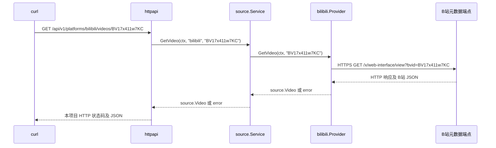
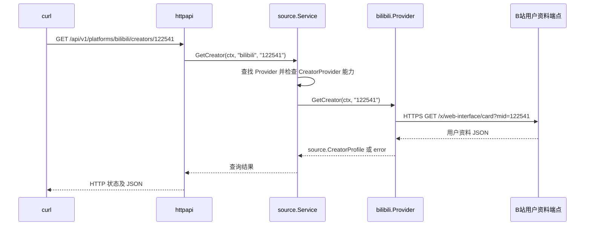

# 服务端查询模块

当前实现一次性视频元数据查询和 UP 主资料查询。视频查询对应 PRD FR-005 的基础元数据获取能力。尚未实现投稿列表发现、可访问性状态机、持久化历史查询和 Agent 同步，不能视为完整实现 FR-005、FR-006 或 FR-008。

<a id="module-navigation"></a>

## 模块导航与维护约定

下表链接均相对于本文件所在的 `docs/` 目录，可在支持本地 Markdown 链接的查看器中打开对应代码。代码文件的模块注释反向注明本文档位置，文档路径以仓库根目录为基准。

| 模块或独立职责 | 功能与边界 | 实现入口与关键符号 | 相关测试 |
|---|---|---|---|
| 服务启动 | 组装数据源和查询服务、读取配置、管理 HTTP 服务生命周期 | [main.go](../backend/cmd/server/main.go) 的 `main` | 使用本文的启动、健康检查和查询命令验证 |
| 通用查询层 | 定义统一数据与错误，按平台和能力分发；平台格式校验交给适配器 | [source.go](../backend/internal/source/source.go) 的 `Provider`、`CreatorProvider`、`Service` | [source_test.go](../backend/internal/source/source_test.go) |
| HTTP API | 接收调用方请求，提取参数，设置查询超时并返回 JSON | [handler.go](../backend/internal/httpapi/handler.go) 的 `Querier`、`New` | [handler_test.go](../backend/internal/httpapi/handler_test.go) |
| B站 Provider 与视频查询 | 初始化客户端、校验 BV、转换视频元数据和业务错误 | [bilibili.go](../backend/internal/provider/bilibili/bilibili.go) 的 `Provider`、`GetVideo` | [bilibili_test.go](../backend/internal/provider/bilibili/bilibili_test.go) |
| B站 UP 主资料查询 | 校验 UID、查询并归一化资料；不获取投稿列表 | [creator.go](../backend/internal/provider/bilibili/creator.go) 的 `GetCreator` | [creator_test.go](../backend/internal/provider/bilibili/creator_test.go) |
| B站共用请求处理 | 发送上游请求，检查 HTTP 和业务状态、响应大小及 JSON；字段语义交给各查询实现 | [http.go](../backend/internal/provider/bilibili/http.go) 的 `get` | 由 [视频测试](../backend/internal/provider/bilibili/bilibili_test.go) 和 [资料测试](../backend/internal/provider/bilibili/creator_test.go) 覆盖 |

注释与技术文档分工：包注释和文件头说明模块职责、边界及文档位置；接口、关键方法和复杂逻辑附近解释输入约束、错误语义及设计原因；本文负责模块关系、执行链路、API、字段映射及扩展方式。普通赋值和显而易见的调用不需要逐行注释。

新增或移动模块、变更接口或职责时，同步更新上述导航及相关章节。定位实现优先使用文件链接和符号名，避免固定行号随着代码调整而失效。具体要求见 [AGENTS.md](../AGENTS.md)。

## 模块边界

```text
backend/cmd/server                 组装 Provider、查询服务和 HTTP 服务
        ↓
backend/internal/httpapi           路由、查询超时、统一 JSON 和错误响应
        ↓
backend/internal/source            通用 Provider 接口、Video、CreatorProfile、错误与分发
        ↑
backend/internal/provider/bilibili B站标识校验、HTTP 请求、响应解析和字段转换
```

依赖方向由适配器指向通用契约。HTTP 层不导入 B站实现，只有启动入口负责组装具体 Provider。查询模块不依赖用户、订阅、数据库或 HTTP 服务，可直接通过 `Service.GetVideo(ctx, platform, id)` 或 `Service.GetCreator(ctx, platform, id)` 调用。

平台 ID、视频 ID 和作者 ID 均使用字符串。视频的唯一业务标识是 `(platform, id)`，不要把 B站 BV 或 UID 的格式限制放到通用类型中。

新增平台时：

1. 在 `internal/provider/<platform>` 实现 `source.Provider` 的 `Platform()` 和 `GetVideo()`。
2. 转换为 `source.Video`，将可识别的查询错误转换为 `source.Error`，保留上下文取消和超时错误。
3. 在 `cmd/server` 的 `source.NewService(...)` 中注册，无需修改 HTTP 路由。

`Service` 在构造时拒绝重复的平台，运行期间不修改注册表；Provider 需要支持并发调用。

## 启动时如何组装服务

入口为 [main.go](../backend/cmd/server/main.go)。执行 `go run ./cmd/server` 或运行已编译程序时，依次完成：

1. `bilibili.New()` 创建 B站 Provider，内部持有一个可复用的 `http.Client`，此时还不查询 B站。
2. `source.NewService(bilibili.New())` 创建查询服务，按 Provider 的 `Platform()` 返回值注册为 `providers["bilibili"]`。
3. `httpapi.New(queries)` 创建路由器，将查询服务传给 HTTP 处理函数。
4. `http.Server` 使用该路由器作为 `Handler`，`ListenAndServe()` 开始监听并处理请求。

对应的核心代码为：

```go
queries, err := source.NewService(bilibili.New())
// 实际代码在这里检查 err。
server := &http.Server{
    Addr:    addr,
    Handler: httpapi.New(queries),
}
// 实际代码还配置了超时、信号处理和关闭逻辑。
err = server.ListenAndServe()
```

监听地址由 `main.go` 读取环境变量 `BHT_ADDR` 决定，未设置时为 `127.0.0.1:8181`。`127.0.0.1` 表示本机回环地址，`8181` 是本项目服务的端口。

例如，在启动服务的 PowerShell 中设置：

```powershell
cd backend
$env:BHT_ADDR = "127.0.0.1:9090"
go run ./cmd/server
```

之后查询地址相应改成 `http://127.0.0.1:9090/...`。环境变量需要在启动前设置，修改后需要重启服务；修改此地址不会改变 B站的上游端点。

## 从 curl 到响应的完整链路

在保持服务运行的同时，另开一个终端执行：

```powershell
curl.exe "http://127.0.0.1:8181/api/v1/platforms/bilibili/videos/BV17x411w7KC"
```

命令中直接填写 URL，不要把 Markdown 的 `[文字](链接)` 格式复制进命令。这里没有指定请求体或其他方法，curl 默认发起 GET 请求。

本次查询涉及两段网络通信：curl 向本项目服务发送 HTTP 请求，本项目服务再作为 HTTP 客户端向 B站发送 HTTPS 请求。`httpapi` 处理第一段，B站 Provider 处理第二段。



成功路径的具体步骤如下：

1. curl 连接本机 `8181` 端口，将请求交给运行中的 Go HTTP 服务。
2. Go 标准库 `http.ServeMux` 匹配 GET 方法和路由模板，进入 `httpapi.New()` 中注册的处理函数。
3. 处理函数从路径中取出 `platform="bilibili"` 和 `id="BV17x411w7KC"`，创建带 12 秒超时的请求上下文。
4. `source.Service.GetVideo()` 用平台名查找已注册的 Provider，并把视频 ID 和上下文传给它。这个步骤不拼接 B站 URL，也不发起网络请求。
5. `bilibili.Provider.GetVideo()` 校验 BV 格式，构造 B站查询 URL，通过公共 `get()` 方法调用 `p.client.Do(req)` 发起上游请求。
6. Provider 检查上游 HTTP 状态、读取有大小上限的响应体，再检查 JSON 业务码 `code`。HTTP 200 和 `code=0` 是两项独立检查，不能只看 HTTP 状态就认定查询成功。
7. Provider 解析 B站字段，转换为通用的 `source.Video`，经过查询服务返回给 `httpapi`。
8. `httpapi` 把结果包装成 `{"data": ...}`，设置 HTTP 200、JSON 内容类型和 `Cache-Control: no-store`，通过 `json.NewEncoder(w).Encode(...)` 写回连接。
9. curl 接收响应并把 JSON 正文打印到终端。当前命令没有加 `-i`，所以不会同时打印 HTTP 响应头。

当前没有本地数据库或缓存，每次查询都会重新执行上游查询。这里的返回链路是同一个请求内的同步调用，不经过后台任务队列。

## httpapi 与 B站 Provider 的职责

`httpapi` 是本项目对调用方提供 HTTP API 的入口。它通过 `Querier` 接口调用查询服务；该接口包含 `GetVideo` 和 `GetCreator`。Go 的接口采用隐式实现，`*source.Service` 具有匹配的方法，因此能够直接传给 `httpapi.New()`。

B站 Provider 的实现位于 `backend/internal/provider/bilibili` 包，具体类型为 `*bilibili.Provider`，负责适配 B站的数据获取方式。

| 模块 | 输入 | 负责的工作 | 输出 |
|---|---|---|---|
| `httpapi` | curl 等调用方的 HTTP 请求 | 匹配路由、提取参数、设置查询超时、映射错误和编码 JSON | 本项目 HTTP 响应 |
| `source.Service` | 平台名、视频 ID 或作者 ID、上下文 | 根据平台名选择数据源，并检查所需能力 | 通用 `source.Video`、`source.CreatorProfile` 或错误 |
| `bilibili.Provider` | BV 号或 UID、上下文 | 校验标识、请求 B站、解析响应、归一化字段 | 通用 `source.Video`、`source.CreatorProfile` 或错误 |

`httpapi` 不导入 B站包，不需要知道 B站接口路径、BV 校验规则或 B站业务码。B站 Provider 不处理本项目的 `ResponseWriter`，也不决定 curl 最终收到的 HTTP 状态码。启动入口负责把这些模块连接起来。

新增平台时，实现相同的 `source.Provider` 接口并在启动入口注册即可。注册表不会自动扫描目录；只创建新文件而不注册，不会使新平台生效。支持作者资料查询的平台还需实现可选的 `source.CreatorProvider` 接口；仅支持视频的平台可以继续注册，作者资料请求将返回 HTTP 501 和 `unsupported_operation`。现有通用 HTTP 路由均可复用。

## HTTP 接口

`GET /healthz` 仅检查进程可用，不请求上游。

`GET /api/v1/platforms/{platform}/videos/{id}` 当前支持 `platform=bilibili` 和完整 BV 号。请求不接受任意上游 URL。

`GET /api/v1/platforms/{platform}/creators/{id}` 当前支持 `platform=bilibili` 和 UP 主 UID。资料查询和视频查询是两条独立路由，不会自动查询投稿列表。

### 本项目 API 路由如何设置

路由在 [handler.go](../backend/internal/httpapi/handler.go) 的 `New()` 中注册：

```go
mux := http.NewServeMux()
mux.HandleFunc("GET /api/v1/platforms/{platform}/videos/{id}", func(w http.ResponseWriter, r *http.Request) {
    ctx, cancel := context.WithTimeout(r.Context(), 12*time.Second)
    defer cancel()
    video, err := queries.GetVideo(ctx, r.PathValue("platform"), r.PathValue("id"))
    // 后续代码处理 err，或把 video 编码为 JSON 返回。
})
```

模板各部分的含义如下：

| 部分 | 含义 |
|---|---|
| `GET` | HTTP 方法；这段路由语法要求 Go 1.22 或更高版本 |
| `/api/v1` | 本项目约定的 API 前缀和版本号，属于路由中的固定文本 |
| `/platforms/{platform}` | 平台资源及平台名路径参数，本次值为 `bilibili` |
| `/videos/{id}` | 视频资源及视频 ID 路径参数，本次值为 `BV17x411w7KC` |

`r.PathValue(...)` 的参数名对应模板花括号中的名字。这是内存中的路由匹配，不要求磁盘上存在 `api/v1/platforms/...` 目录。`bilibili` 是参数值，具体使用哪个实现由查询服务的注册表决定。

Go 路由器也会将 HEAD 匹配到 GET 路由；其他未注册的方法返回 405，未匹配的路径返回 404。这两类响应由标准库路由器生成，当前不是本项目的 JSON 错误格式。

### 成功与错误响应

成功响应示例（示例内容为构造数据）：

```json
{
  "data": {
    "platform": "bilibili",
    "id": "BV17x411w7KC",
    "title": "示例标题",
    "description": "示例简介",
    "url": "https://www.bilibili.com/video/BV17x411w7KC",
    "cover_url": "https://example.com/cover.jpg",
    "creator": { "id": "12345", "name": "示例UP" },
    "published_at": "2023-11-14T22:13:20Z",
    "duration_seconds": 42,
    "observed_at": "2026-11-01T00:00:00Z",
    "source_url": "https://api.bilibili.com/x/web-interface/view?bvid=BV17x411w7KC"
  }
}
```

时间使用 UTC RFC3339。来源没有返回发布时间时，`published_at` 为 `null`，不会用首次查询时间代替。`observed_at` 是本次成功读取并解析结果的时间，不是内容修改或消失时间。

失败响应为 `{"error":{"code":"access_restricted"}}` 等，不透传上游响应正文或底层网络错误。

| HTTP 状态 | error.code | 含义 |
|---|---|---|
| 400 | invalid_input | 视频标识格式无效或上游明确拒绝参数 |
| 404 | unsupported_platform | 没有注册对应平台 |
| 501 | unsupported_operation | 平台已注册，但未实现当前查询能力 |
| 404 | not_found | 上游业务响应表示未找到，不表示已确认删除 |
| 502 | access_restricted | 上游拒绝访问或需要权限，包括 HTTP 412 |
| 503 | rate_limited | 上游限流，当前不能完成查询 |
| 502 | invalid_response | 缺少必要字段、视频 ID 不匹配、非法 JSON 或响应超过 2 MiB |
| 502 | upstream_failure | 网络错误、上游服务错误或未知业务错误 |
| 504 | upstream_failure | 上游查询超时 |
| 408 | upstream_failure | 请求上下文被取消（连接断开时客户端可能收不到响应） |

B站 API 路由本身返回 HTTP 404 时映射为 `upstream_failure`；只有可解析的业务错误 `code=-404` 才映射为 `not_found`。没有依据时，不将访问失败转化为“视频已删除”。

## B站适配器范围

### 服务端在哪里请求 B站

视频查询入口位于 [bilibili.go](../backend/internal/provider/bilibili/bilibili.go) 的 `GetVideo()` 中。B站地址由同文件的 `videoEndpoint` 常量指定，与本项目提供给 curl 的路由相互独立：

```go
const videoEndpoint = "https://api.bilibili.com/x/web-interface/view"

// GetVideo 内部：
endpoint := videoEndpoint + "?" + url.Values{"bvid": {id}}.Encode()
var data videoData
err := p.get(ctx, endpoint, &data)
```

视频和 UP 主资料查询共用 [http.go](../backend/internal/provider/bilibili/http.go) 的 `get()`，实际网络请求在这里发送：

```go
req, err := http.NewRequestWithContext(ctx, http.MethodGet, endpoint, nil)
// 实际代码在这里检查 err，并设置 Accept 和 User-Agent 请求头。
resp, err := p.client.Do(req) // 真正向 B站发送请求的位置。
```

本次实际查询的上游地址是：

```text
https://api.bilibili.com/x/web-interface/view?bvid=BV17x411w7KC
```

如果要修改本项目的对外路径，修改 `httpapi` 的路由注册；如果 B站的端点或响应格式变化，修改 B站 Provider；如果要修改本项目监听的 IP 或端口，设置 `BHT_ADDR`。三者分别负责不同配置。

### B站字段如何转换为返回结果

Provider 先从 B站返回的 `data` 中读取字段，再构造 `source.Video`，不会把上游完整响应原样透传。

| 本项目字段 | 来源或处理方式 |
|---|---|
| `platform` | Provider 固定为 `bilibili` |
| `id` | B站 `bvid`，同时要求与本次请求的 BV 一致 |
| `title` | B站 `title` |
| `description` | B站 `desc` |
| `cover_url` | B站 `pic`，仅返回地址，不下载封面 |
| `creator.id` | B站 `owner.mid`，转换为字符串 |
| `creator.name` | B站 `owner.name` |
| `published_at` | B站 `pubdate` 秒级 Unix 时间，转换为 UTC 时间；没有时间则为 `null` |
| `duration_seconds` | B站 `duration`，单位为秒 |
| `url` | 使用 BV 拼接 B站视频页面地址 |
| `observed_at` | 本服务解析成功时的 `time.Now().UTC()` |
| `source_url` | 本次构造并请求的上游查询地址 |

因此，响应里的 `published_at` 和 `observed_at` 含义不同：前者来自 B站投稿时间，后者来自本服务的观测时间。JSON 时间末尾的 `Z` 表示 UTC；在北京时间显示时需要加 8 小时。

当前请求 `GET https://api.bilibili.com/x/web-interface/view?bvid=...`，不使用个人认证凭据，不跟随重定向，不获取播放链接和视频内容。这是网页端点的实验性接入，不能由一次查询成功推导出长期可用性或任意目标的授权范围；正式运行条件仍以 PRD 的真实数据源验证要求为准。

每次查询主动发起一次上游请求，没有应用层自动重试。HTTP 客户端超时 10 秒，HTTP 入口上下文超时 12 秒；上下文沿 `httpapi → Service → Provider → HTTP 请求` 传递，客户端断开或超时时可取消上游调用。服务默认只监听本机。第一版没有缓存、调度器或跨请求限流，尚不适合直接对公网开放高频查询。

适配器只输出元数据，没有 `AVAILABLE` 或“已删除”状态。后续状态机必须另行记录观测依据、失败原因与确认次数；元数据可读取不等于当前可播放。

UID 投稿列表扫描暂未实现。后续可增加独立的列表查询能力契约，以不透明分页游标隔离平台差异，而不强制所有平台 Provider 都支持投稿列表。

## 按 UID 查询 UP 主资料

请求示例（服务默认端口为 `8181`）：

```powershell
curl.exe "http://127.0.0.1:8181/api/v1/platforms/bilibili/creators/122541"
```

也可以在 PowerShell 中格式化显示：

```powershell
Invoke-RestMethod -Uri "http://127.0.0.1:8181/api/v1/platforms/bilibili/creators/122541" | ConvertTo-Json -Depth 5
```

成功响应示例（内容为构造数据，字段名与实际实现一致）：

```json
{
  "data": {
    "platform": "bilibili",
    "id": "122541",
    "name": "示例UP",
    "description": "个人签名",
    "avatar_url": "https://example.com/avatar.jpg",
    "url": "https://space.bilibili.com/122541",
    "follower_count": 1234,
    "observed_at": "2026-11-04T00:00:00Z",
    "source_url": "https://api.bilibili.com/x/web-interface/card?mid=122541"
  }
}
```

### 查询链路与平台能力



通用类型及能力接口位于 [source.go](../backend/internal/source/source.go)：

```go
type CreatorProvider interface {
    GetCreator(ctx context.Context, id string) (CreatorProfile, error)
}
```

`source.Service.GetCreator()` 先验证平台和 ID 是否为空，再查找已注册的平台，使用接口断言检查资料查询能力，最后调用具体 Provider。UID 的具体格式只由 B站适配器校验，其他平台的作者 ID 可以采用其他格式。

保留视频结果中原有的 `Creator{ID, Name}` 简要作者引用，单独使用 `CreatorProfile` 表示资料查询结果，避免给现有视频接口增加未知的作者资料字段。

### B站端点、输入与字段映射

实现位于 [creator.go](../backend/internal/provider/bilibili/creator.go)，使用固定端点 `https://api.bilibili.com/x/web-interface/card`，将 UID 放入 `mid` 查询参数。不接受任意上游 URL，不使用 Cookie，不会请求该 UID 的投稿列表。

UID 必须是规范的正十进制整数，范围为 `1` 到 `9223372036854775807`。空值、零、正负号、前导零、空格、小数、科学计数法、溢出值和个人空间链接均不接受；到达 Provider 的无效值会在发起上游请求前返回 `invalid_input`。HTTP 路径中完全缺失 ID 时，由路由器返回 404。

| 本项目字段 | 来源或处理方式 |
|---|---|
| `platform` | 固定为 `bilibili` |
| `id` | 请求 UID，并校验响应 `data.card.mid` 与它相等 |
| `name` | `data.card.name`，为空视为无效响应 |
| `description` | `data.card.sign`（个人签名），缺失时为空字符串 |
| `avatar_url` | `data.card.face`，缺失时为空字符串；仅返回地址 |
| `url` | 使用 UID 拼接个人空间地址 |
| `follower_count` | `data.follower`，缺失或为 `null` 时保持 `null`；负值视为无效响应 |
| `observed_at` | 本服务成功解析时的 UTC 时间 |
| `source_url` | 本次上游查询 URL |

B站的 `card.mid` 可以是字符串形式，解析时使用 `json.Number` 同时兼容字符串和整数，避免经过浮点数导致大 UID 精度丢失。错误响应沿用视频查询的分类、超时和 2 MiB 响应体限制；接口返回未知资料时，不推断账号已注销。

这一步只建立单个 UP 主的资料查询能力，返回的粉丝数是本次观测值，不是历史统计。后续获取全部投稿需要另行实现分页列表能力和相应调度。

## 验证

运行 `cd backend` 后执行 `go test ./...`、`go vet ./...` 和 `go build -o bin/server.exe ./cmd/server`。自动化测试使用本地构造的上游响应，不依赖 B站网络可用性，覆盖字段归一化、BV/UID 校验、UID 精度、未知与零粉丝数、访问限制、限流、无效响应、响应体上限、取消和超时传播，以及多平台能力分发和两类 HTTP 接口的错误映射。当前仓库没有 `package.json` 或 `.github/workflows`，Go 服务的检查由这些命令执行。
