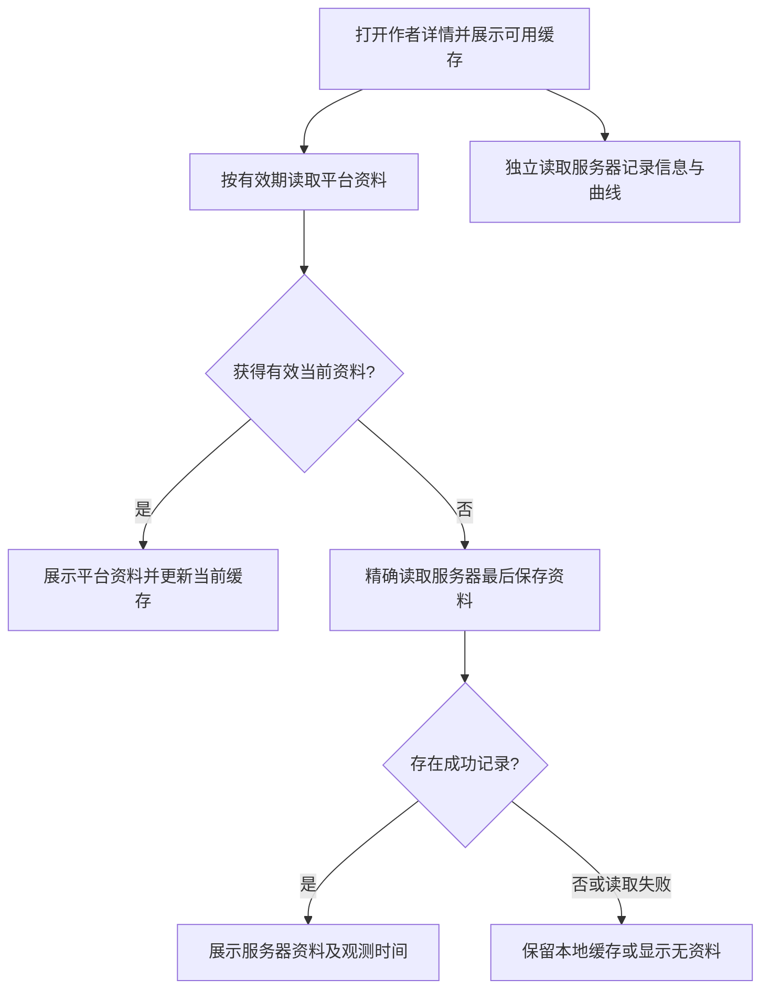

# 作者详情的数据来源与服务器回退设计

- 创建时间：2026-11-19 11:19（Asia/Shanghai）。
- 状态：方案已确认，待实施；本分支从 `548f18555585b0e0e73a1fa36f2e26ce8c1cb9a5` 建立，只交付设计与任务文档，不包含 T2 接口实现。
- 实施任务：[详情数据来源与按需历史](../PLANs/2026-11-19-client-detail-data-sources.md)。

## 目标与范围

Agent 负责获取平台当前可查询的资料、保存本地缓存、维护私人关注和组合视频列表；服务器负责持续采集、历史统计、资料版本和公共跟踪状态。作者详情默认显示当前资料、服务器记录的当前版本 seq、粉丝曲线及本地已关注视频。历史版本列表和内容对比按需加载。

平台当前资料获取失败时，允许额外读取服务器最后保存的资料，覆盖平台不可达、接口返回异常，以及 UP 或视频已无法从平台查询等场景。服务器资料是历史观测，不能称为平台实时资料；平台查询失败也不能直接判定目标已删除。

首期落实作者详情和该页本地已关注视频的取数方式，并为作者、视频当前资料建立一致的来源与回退契约。独立视频详情的历史面板迁移可后续复用，不能因本设计自动扩大到全站页面重构。保留现有采集、数据库版本与统计表、私人关注语义、服务器管理台和旧公共接口；不迁移或清理已有历史数据。

## 数据归属与显示口径

| 数据 | 首选来源 | 回退或边界 |
|---|---|---|
| 当前昵称、简介、头像；视频标题、描述、封面、发布时间 | Agent 直接查询平台并缓存 | 平台失败后读取服务器最后保存资料；仍失败时保留已有本地缓存 |
| 当前粉丝数、当前播放量 | Agent 查询平台 | 平台缺少该字段时保持未知；整个资料请求失败才走服务器回退，不能把缺失补成零 |
| 历史粉丝、播放量曲线 | 服务器 `metric_samples` | 只含服务器真实日采样，不混入 Agent 即时值，不补零 |
| 服务器记录的当前 seq、最近资料观测时间 | 服务器当前作者或视频表 | seq 表示服务器最新记录版本，不是平台版本，也不是通过计数得到的版本总数 |
| 公共任务是否存在、启停、最近成功或失败、进程内运行状态 | 服务器任务表及 tracker 内存 | 不由本地关注推断；读取失败显示未知，不伪造 absent 或 paused |
| 历史版本列表、指定版本快照、版本差异 | 服务器版本表 | 点击历史入口后读取；比较时才取所需两版 |
| 我关注的视频、关注时间、扫描来源、筛选排序分页 | Agent 本地状态及已知归属 | 不代表服务器全局跟踪列表；未知归属不猜测 |
| 平台可见投稿、合作投稿发现 | Agent 显式扫描的已有结果 | 打开详情不自动扫描，不将发现结果当作完整平台全集 |
| 服务器全局收录或跟踪的视频 | 服务器公共目录 | 单独按需访问，不纳入作者基础详情 |

平台查询成功但某个可选字段缺失，不触发整份资料回退；头像下载失败保留占位，不为图片反复请求服务器完整详情。服务器最后保存的粉丝数或播放量可以在回退资料中显示，但必须随资料来源和观测时间一起标明。

示例：Agent 查到“新名字、10 万粉丝”，服务器仍保存“旧名字、9.9 万粉丝、v23”。页面显示平台当前资料，并单独显示“服务器记录 v23，最近观测时间”；不能把“新名字”标为服务器 v23。平台查询失败时，改为显示“旧名字、9.9 万粉丝”，并注明“服务器最后记录”和实际观测时间。当前表的观测时间与版本快照创建时间可能不同：内容未变时不会新建版本，不得用版本创建时间冒充最近成功观测。

## 协作关系

下图表示目标调用关系，结果沿调用路径返回。浏览器只访问本地 Agent；平台查询和服务器查询由 Agent 分别发出。

```text
+----------------------------------+
| Browser: current / curve / videos |
+----------------------------------+
                 | local HTTP
                 v
+----------------------------------+
| Agent: compose / cache / follows  |
+----------------------------------+
       | current             | history / tracking
       v                     v
+------------------+  +--------------------------+
| Platform API     |  | Server public API :8181  |
| current metadata |  | metadata / curve         |
+------------------+  +--------------------------+
       | failure             | exact SQL
       |                     v
       |              +--------------------------+
       +-- fallback ->| Server last saved data   |
                      | current + current version|
                      +--------------------------+
```

Agent 的平台读取不调用服务器实时查询接口来转发上游请求，也不把本地观测上传成服务器版本或统计采样。服务器原有调度器继续独立采集，作者采集不自动关注其视频。

## 打开详情与失败回退

1. 根据平台、类型、ID 加载本地当前资料缓存和本地关注视频；可用缓存先展示，标注来源与观测时间。
2. 当前资料分支按缓存有效期查询平台；历史分支独立请求服务器的 seq、跟踪信息和粉丝曲线。两个分支可并发，互不阻塞整页展示。
3. 平台资料成功后更新独立的当前资料缓存，拒绝错误身份响应；不改写服务器历史缓存和版本号。
4. 平台请求超时、失败、无法获得有效目标资料时，才请求服务器的“最后保存资料”。此请求只读已有记录，不触发实时平台查询、采集、任务申请或暂停恢复。
5. 服务器有成功资料时，展示该资料并标记来源、资料观测时间和回退原因；返回的 seq 与该回退资料绑定。
6. 服务器没有成功资料或不可达时保留已有本地缓存及其原始来源、观测时间；无缓存则显示“当前资料暂不可获取”，仍可展示独立成功的曲线、跟踪状态及本地视频列表。

文字流程：先展示缓存；平台当前资料与服务器历史分别读取；仅平台资料分支失败时增加服务器资料回退；所有来源都失败才进入无资料状态。



删除、平台限制、业务失败和网络失败可以携带不同原因提示，但不会仅凭一次查询失败建立“已删除”状态。HTTP 200 仍要检查业务结果和目标身份。服务器历史请求失败不触发当前资料回退；平台请求成功时照常显示当前资料。

## 查询预算与原流程变化

以下数字指无重试、无额外页面操作的逻辑 SQL 执行次数，不是访问表数，也不包括服务器后台采集。

| 路径 | SQL 预算 | 查询内容 |
|---|---:|---|
| 作者基础历史请求 | 2 | 一次按 ID 读取作者 seq、资料观测时间与任务状态；一次按目标及时间范围读取粉丝采样 |
| 平台当前资料成功 | 额外 0 | 正常路径不读版本快照，不从快照提取头像 |
| 平台失败后读取服务器资料 | 额外最多 1 | 按 ID 读取当前作者，按当前 seq 关联当前版本；在同一查询中返回可展示的最后保存资料 |
| 平台和服务器都没有资料 | 不追加探测查询 | 回退查询的空结果已表达缺失；作者占位 seq=0 不算成功资料 |
| 本地已关注视频列表 | 服务器 SQL 为 0 | Agent 用关注、归属与缓存完成筛选排序分页 |
| 历史列表、快照、视频资料主动更新 | 单独计量 | 用户操作或受控后台更新触发，不计入基础详情预算 |

正常路径目标为 2 次 SQL；一次平台失败后的完整路径目标为最多 3 次。缓存有效且无需网络的分支可以更少。第一条通过作者与任务的关联读取处理“有作者无任务、有任务无作者、两者都无”的状态，不允许为识别缺失再调用通用目录查询；`running` 从 tracker 读取，不增加 SQL。两条查询不宣称是同一事务快照，返回各自观测信息。

服务器回退资料只需当前版本的一行；简介等字段需要快照时才读取 payload。回退结果使用本次实际返回的 seq，不能套用稍早的基础请求 seq，避免采集并发推进版本时错误标记。回退资料是“服务器最后保存”，不提供指定历史版本；历史原始快照由按需接口处理。

原成功且不带快照参数的详情通常有 8 次 SQL：通用目录计数与取数、版本计数与列表、指标、任务状态、重复目录计数与取数。新流程移除目录计数、重复资料查询和非目标范围聚合；延后版本计数、列表与差异读取。前端也停止打开作者页就自动读取当前及上一版快照。正常路径不再读当前版本；回退时才恢复一次精确读取。

当前实现见 [publicapi/read.go](../backend/internal/publicapi/read.go) 的 `clientDetail`、[response.go](../backend/internal/publicapi/response.go) 的 `targetStatus`、[storage/dashboard.go](../backend/internal/storage/dashboard.go) 的 `Content/Catalog/Metrics/Versions/ReadSnapshot`。这些旧入口不能直接充当轻量回退，否则会重新引入全部计数和聚合。

## 接口与兼容边界

接口按职责拆分，实施时在现有路由风格下确定最终路径并同步 [公共协议](public-api.md)、[业务应答](public-response.md) 和 Agent 接口说明。下列是必须实现的契约职责，不是已经存在的新路由：

| 读取职责 | 输入 | 输出与约束 |
|---|---|---|
| Agent 当前资料 | 平台、类型、规范 ID、显式刷新选项 | 归一化资料、实际来源、观测时间、缓存状态、回退原因；原始 Cookie 不返回浏览器 |
| 服务器基础历史 | 目标、7/30/90 日或全部 | 记录存在性、seq、最近观测、跟踪信息、采样与截断标记；不附带版本列表、完整当前资料、视频汇总 |
| 服务器最后保存资料 | 目标 | 成功资料及其 seq、资料观测时间、快照创建时间；无资料返回明确业务状态，内部错误不伪装成缺失 |
| 服务器历史版本列表 | 目标、分页参数 | 按需版本项；默认不为基础页统计总数，可用有界续页与 has_more |
| 服务器指定快照 | 目标、正整数 seq | 只读指定版本；不重复返回当前资料、曲线、列表或跟踪状态 |

本地响应应把当前资料、服务器记录信息、历史曲线及各分支错误分开，不能继续用一个混合 `item` 同时表示平台当前状态和服务器版本。字段名在实施任务中冻结，至少能表达：平台/类型/ID、资料实际来源（平台或服务器）、资料观测时间、是否缓存及最后检查时间、服务器来源地址、绑定 seq（仅服务器资料）、平台读取失败原因。没有对应服务器来源时不得填造 seq。

新客户端使用专用轻量入口；旧详情、目录和管理台先保持兼容，避免悄然删除旧客户端依赖的字段。旧服务缺少新能力时显示能力不足或使用已有缓存；若提供显式旧协议兼容读取，需单独标注其成本，不能计入 2/3 次 SQL 验收，也不能自动循环回到重型旧详情。

## 缓存、图片与视频列表

- 平台当前资料与服务器历史缓存独立保存。平台缓存按平台、类型、ID 及实际读取上下文隔离；使用登录态可见性时纳入身份代际，不混用不同账号结果。首期公开元数据默认不附 Cookie，登录态扫描继续使用原流程。
- 服务器缓存按服务器地址/代际、目标及数据范围隔离；切服丢弃旧服务器缓存，不必丢弃身份匹配的平台公开资料缓存。服务器回退内容不能写入平台成功缓存并改变来源。
- 同目标平台查询与服务器回退分别合并在途请求；建议首期当前资料有效期 5 分钟、失败退避 1 分钟、平台读取预算 8 秒、回退预算 5 秒，实施阶段通过平台桩与取消测试校准。以上为设计初值，不是现有代码常量或性能承诺。
- 有效缓存直接展示；过期缓存先展示，再后台刷新。显式刷新可绕过成功缓存有效期，但保留在途合并与失败退避，不因页面切换无限重试；平台与回退请求均支持取消，旧路由、旧服务器和取关重关注的迟到响应按身份/代际拒绝写回。
- 私人关注的新增、取消、提交退避、暂停不恢复等约束保持；浏览视频列表不自动逐项同步服务器摘要或申请跟踪。已有后台关注核对继续独立运行，不能把它的 SQL 宣称为详情预算中的零成本。
- 视频区默认只读本地关注和缓存。需要当前标题/播放量时采用显式刷新或有界后台更新；不能打开一个作者就请求其所有视频。已有历史增长缓存可标时间展示，缺失时显示未知，不通过打开页面逐条补曲线。
- 当前头像/封面优先使用平台资料直接返回的地址，并沿用图片域名白名单；服务器回退在同次资料查询中提供所需图片地址。不得因图片懒加载再调用整套旧详情。历史版本图片仅在用户查看该版时解析。
- 缓存为空时旧关注可能没有作者归属，继续显示未知，不通过扫描服务器全库猜测或补齐。服务器目录与本地视频列表的总数保持各自口径。

## 性能判断与验证

[现有采样分析](performance-analysis-2026-11-18.md) 中，两次 `Content → Catalog` 路径累计占采样 CPU 的 96.35%，版本读取约 1.22%。32 并发的原 UP 详情 P50 分别为 626.17 ms（60 秒测试）和 771.16 ms（90 秒采样轮），P95 分别为 997.05 ms、1278.20 ms。CPU 占比不是端到端延迟占比，不能据此承诺优化后的毫秒值。

新方案预计主要减少通用目录重复计算、当前版本读取和页面自动附加请求；平台失败路径仍需承担平台尝试与服务器回退时间，不能承诺比平台成功路径更快。回退的额外一次 SQL 是保留已消失资料可访问性的明确成本。

验收必须同时测量：服务器逻辑 SQL 次数/耗时、Agent 平台请求数和回退次数、首屏缓存展示时间、当前资料就绪时间、曲线就绪时间、完整页面附加请求。平台请求可合并多个字段，不能把“服务器 2 次 SQL”称为“全页只有 2 次请求”。固定数据库副本、并发、采集器和限流条件，对正常及回退路径分别测试 1/8/16/32 并发，记录吞吐、P50/P95/P99、错误、CPU 和连接等待；模拟平台结果用于可重复测试，真实平台可用性另行验收。

## 模块导航与实施约束

| 职责 | 现有实现与待调整点 | 相关验证入口 |
|---|---|---|
| 平台当前资料 | [Agent 平台适配器](../client/agent/internal/bilibili/client.go) 目前承担登录与扫描，需增加有边界的元数据能力；字段校验参考 [服务器作者适配器](../backend/internal/provider/bilibili/creator.go) 和 [视频适配器](../backend/internal/provider/bilibili/bilibili.go) | [平台测试](../client/agent/internal/bilibili/client_test.go)，实施补当前资料桩测试 |
| 本地编排与缓存 | [service.go](../client/agent/internal/library/service.go)、[localstate/store.go](../client/agent/internal/localstate/store.go)、[images.go](../client/agent/internal/library/images.go) | [library 测试](../client/agent/internal/library/service_test.go)、[图片测试](../client/agent/internal/library/images_test.go) |
| 历史和回退读取 | [publicapi/read.go](../backend/internal/publicapi/read.go)、[response.go](../backend/internal/publicapi/response.go)、[storage/dashboard.go](../backend/internal/storage/dashboard.go) | [公共读取测试](../backend/internal/publicapi/read_test.go)、[存储测试](../backend/internal/storage/dashboard_test.go) |
| Agent 协议 | [remote/client.go](../client/agent/internal/remote/client.go)、[httpapi/library.go](../client/agent/internal/httpapi/library.go) | [远程协议测试](../client/agent/internal/remote/client_test.go)、[详情 HTTP 测试](../client/agent/internal/httpapi/details_test.go) |
| 页面与本地视频 | [detail.js](../client/frontend/detail.js)、[creator-videos.js](../client/frontend/creator-videos.js)、[library/catalog.go](../client/agent/internal/library/catalog.go)、[summaries.go](../client/agent/internal/library/summaries.go) | [视图测试](../client/frontend/view.test.mjs)、[趋势测试](../client/frontend/trend.test.mjs)、[本地目录测试](../client/agent/internal/library/catalog_test.go) |

新增或调整 Go 职责时更新包/文件头注释与 [架构导航](architecture.md)，实现约束留在代码附近。本文中的接口、预算和行为均需经任务验收后才能改记为已实现。
