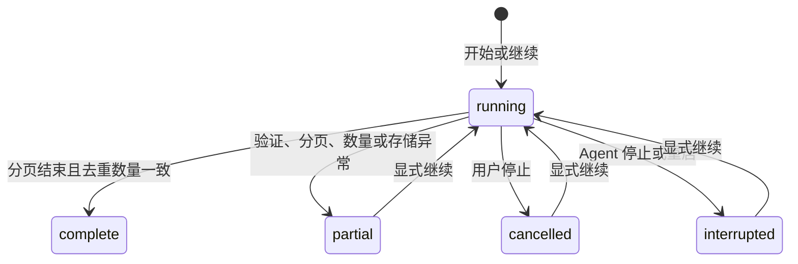

# 本地 Cookie 与 UP 主投稿 ID 扫描

本文描述已实现的客户端首个功能。统一需求与启动见 [client/README.md](../client/README.md)，平台产品范围见 [PRD](PRD.md)，模块与测试索引见 [架构导航](architecture.md#module-navigation)。

## 范围与调用关系

本期只实现手动 Cookie 导入、账号验证、指定 UP 主投稿分页、BV 号清单、取消/继续、TXT/JSON 导出。不接入项目服务器，不建立关注或自动规则，不下载媒体和评论。合作视频可能由其他作者发布，仍保留在该 UP 的投稿列表内，不按响应的 `mid/author` 过滤。

```text
+--------------------------------------+
| frontend: forms / progress / export  |
+--------------------------------------+
                   | same-origin HTTP
                   v
+--------------------------------------+
| httpapi: session / origin / CSRF     |
+--------------------------------------+
                   | configure / scan
                   v
+--------------------------------------+
| scanner: paging / dedup / recovery   |
+--------------------------------------+
                   | login / signed page
                   v
+--------------------------------------+
| bilibili: nav / WBI / arc search     |
+--------------------------------------+
                   | HTTPS + local Cookie
                   v
+--------------------------------------+
| api.bilibili.com                     |
+--------------------------------------+

Storage path:
+--------------------------------------+
| scanner: configure / checkpoint      |
+--------------------------------------+
                   | encrypted Cookie / atomic scan
                   v
+--------------------------------------+
| localstate: local persistence        |
+--------------------------------------+
```

箭头为运行调用或落盘方向，结果沿原调用返回。[frontend.Files](../client/frontend/assets.go) 内嵌界面；[main.run](../client/agent/cmd/agent/main.go) 组装模块，校验回环 IP 后才监听，默认 `127.0.0.1:8183`。

## Cookie 与平台接口

[NormalizeCookie](../client/agent/internal/bilibili/client.go) 接受 Cookie 请求头值及可选 `Cookie:` 前缀，拒绝多行、重复名称、缺少或为空的 `SESSDATA`。验证失败不替换原凭据。页面提交结束后清空输入；配置读取和导出都不返回 Cookie。

账号验证请求固定 `https://api.bilibili.com/x/web-interface/nav`，要求业务码 0、`isLogin=true`、有效账号 ID 与用户名。匿名 nav 也可能有 WBI 材料，材料存在不能证明登录。只保留账号摘要与临时签名材料，不持久化原始响应。

投稿请求固定 `https://api.bilibili.com/x/space/wbi/arc/search`，参数为 `mid`、`pn`、`ps=30`、`order=pubdate`、`tid=0`、`platform=web`、`web_location=1550101`，没有关键词或分区筛选。读取 `data.list.vlist` 与 `data.page.{count,pn,ps}`；保留 `bvid/title/created`。响应必须含分页结构、符合当前页参数且 BV 有效；HTTP 200、code 0 但只返回风控 voucher 不能作为空投稿。

[wbi.go](../client/agent/internal/bilibili/wbi.go) 从 nav 图片文件名提取材料，按协议置换为 32 字符 mixin，加入秒级 `wts`，清除值中的 `!'()*`，按键排序及 URI 编码后计算 `MD5(query + mixin)` 得到 `w_rid`。不请求图片 URL；MD5 仅用于上游协议，不用于本地加密。

请求使用专用客户端，超时 15 秒、响应体上限 4 MiB，拒绝重定向，不把用户输入当请求 URL。每页间隔约 800 毫秒；网络、上游暂时错误或限流最多重试两次，并等待有限退避或冷却。账号失效和验证要求直接暂停，用户在 B站验证后自行继续，不自动绕过验证。

普通网页不能读取其他域名 Cookie；扩展需 `cookies` 及站点权限，参见 [Chrome Cookie API](https://developer.chrome.com/docs/extensions/reference/api/cookies)。本期不读取浏览器数据库，不提供自动获取的模拟入口。

接口参考：[B站 nav](https://api.bilibili.com/x/web-interface/nav)、[投稿原调查文档](https://raw.githubusercontent.com/pskdje/bilibili-API-collect/main/docs/user/space.md)、[WBI 原调查文档](https://raw.githubusercontent.com/pskdje/bilibili-API-collect/main/docs/misc/sign/wbi.md)。网页端点可能变更或触发风控，模拟成功不能证明任意账号持续可用。

## 扫描、完整性与恢复

[scanner.Service](../client/agent/internal/scanner/service.go) 同时只接受一个扫描，期间禁止变更 Cookie。支持规范正整数 UID 或 B站空间链接。任务使用独立 context，刷新或关闭网页不取消任务。

成功页按 BV 去重，结果、平台总量、已完成页和下一页一起原子写入 `scan.json`。没有 120 条上限；展示分页，复制/导出覆盖全部已获取 ID。只保留最近任务，新扫描替换旧任务，需要保留旧清单时先导出。



文字说明：`complete` 仅指本次账号和接口可见范围；其他终态保留结果并支持继续。页完全重复、未覆盖总量却返回空页、总量变化、去重数量与平台总量不一致时均不报告完整，失败页不作为成功页推进。继续时重新验证账号并刷新签名材料，账号必须与原任务一致。

启动时将遗留运行状态改为 `interrupted`，从已保存的下一页继续。列表按投稿时间分页，期间仍可能变化，数量异常时建议重新扫描；不保证扫描前已删除、无权限或接口未展示的视频，不将结果视为不可变快照。磁盘失败不标完整，并提示部分结果可能未落盘。退出 Agent 会取消任务并等待保存。

## 本地 API 与会话

启动生成随机密钥，完整地址为 `http://127.0.0.1:8183/#token=...`。片段不进入 HTTP 查询串，界面读取后立即移除，POST 换取 HttpOnly、SameSite=Strict、最长 12 小时会话。连接密钥只在当前进程有效，与 B站凭据不同；无密钥且无会话时显示连接表单。

所有 API 校验固定 Host、Origin 和 Fetch Metadata；写操作必须同源 JSON 并携带会话绑定的 `X-CSRF-Token`。建立会话的 POST 使用启动密钥验证，其他请求均需会话。不提供 CORS 通配许可或跨设备控制；静态页无平台凭据，响应禁止缓存并设置 CSP 和 no-referrer。

| 路由 | 功能 |
|---|---|
| `POST /api/session` | `{token}` 换本地会话与 CSRF token |
| `GET /api/session` | 已认证会话读取 CSRF token |
| `GET /api/config` | 配置状态、加密持久化支持与账号摘要 |
| `PUT /api/config/cookie` | `{cookie}` 验证并保存 |
| `POST /api/config/validate` | 验证现有 Cookie |
| `DELETE /api/config/cookie` | 清除凭据，保留清单 |
| `POST /api/scan` | `{creator_id,resume}` 开始或继续 |
| `GET /api/scan?offset=0&limit=50` | 摘要与分页结果，limit 为 1–100 |
| `POST /api/scan/cancel` | 停止并保留结果 |
| `GET /api/scan/export?format=txt` | 全部已获取 BV 的逐行 TXT，也支持 `format=json` |

部分导出文件名带 `partial`，完整结果带 `complete`。JSON 含状态、范围、数量和视频项，TXT 只含 BV。错误为 `{error:{code,message}}`，不回显正文、Cookie、上游完整 URL 或原始响应。

## 本地持久化与系统边界

默认目录为启动工作目录下的 `data/`，可用 `-data` 指定；仓库忽略 `client/data/`。`scan.json` 不含 Cookie；写入使用同目录临时文件、同步及替换，保留上次检查点。

Windows `cookie.protected` 使用 [当前用户 DPAPI](https://learn.microsoft.com/en-us/windows/win32/api/dpapi/nf-dpapi-cryptprotectdata)，不启用 `LOCAL_MACHINE`，通常需同一用户与设备解密。保护失败不回退明文；其他系统暂禁用 Cookie 落盘，仅进程内使用，界面说明退出后需重新配置。

不保存服务器凭据、不请求 `backend/`、不访问浏览器凭据库。用户粘贴的 Cookie 只发往固定 B站 HTTPS 接口；不使用浏览器持久化存储保存敏感数据。平台标题使用文本节点，避免 HTML 执行。

## 验证

在 `client/` 运行：

```powershell
go test -timeout 45s ./...
go vet ./...
go build -o bin/agent.exe ./agent/cmd/agent
npm run lint
npm test
```

Go 只依赖标准库，前端使用 Node 内建测试，无需安装项目依赖。入口：[适配器](../client/agent/internal/bilibili/client_test.go)、[凭据与文件](../client/agent/internal/localstate/store_test.go)、[扫描](../client/agent/internal/scanner/service_test.go)、[HTTP 闭环](../client/agent/internal/httpapi/server_test.go)、[界面状态](../client/frontend/view.test.mjs)。

覆盖固定 WBI 向量、匿名 nav、合作视频、风控响应、拒绝重定向、超过 120 条、分页停滞/空页、数量变化、停止/继续、重启恢复、账号限制、加密与清除、Host/Origin/CSRF、分页及导出。Edge 桌面和手机尺寸联调使用真实本地会话及模拟 API，验证 Cookie 清空、135 条分页/复制/导出、取消/继续、标题文本渲染和无页面溢出。

未使用真实用户 Cookie 执行平台全量枚举，真实账号与风控表现需用户在本机配置后验证，不将模拟结果写成真实平台验收通过。测试只使用临时目录与测试 Cookie。
