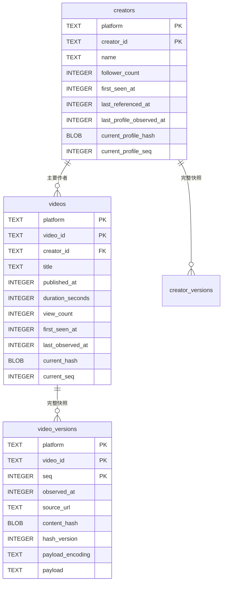
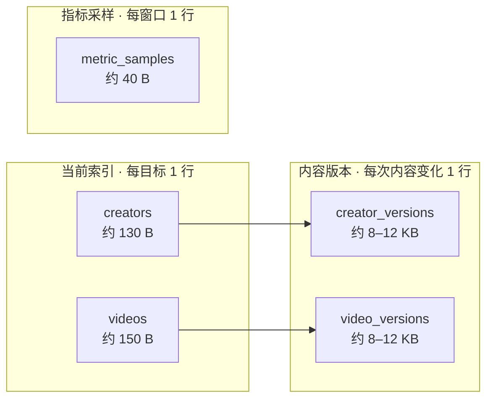
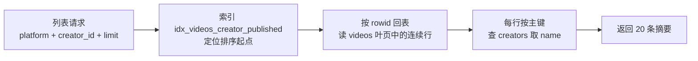

# 数据库设计：当前索引、完整快照与指标采样

设计已由 `backend/internal/storage/migrations/0001_init.sql` 落地，`PRAGMA user_version = 1`；当前服务在成功查询后自动写入。内容设计为五张表，分成三类职责：

| 类别 | 表 | 保存什么 | 增长方式 |
|---|---|---|---|
| 当前索引 | `creators`、`videos` | 展示、排序、调度需要的最新值 + 当前版本指针 | 每个目标一行，原地更新 |
| 内容版本 | `creator_versions`、`video_versions` | **完整上游快照** + 内容指纹 | 只在实际内容变化时追加 |
| 指标采样 | `metric_samples` | 播放量、粉丝数的时间序列 | 按采样窗口追加 |

核心取舍是：**快照尽量宽，指纹尽量窄，写入尽量少**。版本行保存完整上游数据，可以重新解析和复原；指纹只覆盖稳定的内容字段，播放量变化不会制造新版本；内容没变时既不构造快照也不写版本。

以下 SQL 以 SQLite 为示例，尚不是运行中的迁移。

## 为什么必须先分开三类变化

| 变化类型 | 例子 | 频率 | 存放位置 |
|---|---|---|---|
| 内容变化 | 标题、简介、封面、分P结构、作者昵称、签名、头像 | 极低 | 版本表（写完整快照） |
| 计数变化 | 播放量、点赞、弹幕、收藏、粉丝数 | 每次查询都变 | 当前表整数列，原地覆盖 |
| 状态变化 | 可访问、受限、审核 | 低但关键 | 完整快照里保留证据，但**不参与内容指纹**；状态机后续单独设计 |

如果让内容指纹覆盖接口返回的全部字段，播放量每增加一次就会产生一条版本，版本表实际变成每次查询的日志。按 1 万个视频、每天查询 4 次估算，全量记录约 1460 万行/年；而只记录真实内容变化，按每个视频每年变化 3 次估算约 3 万行/年。

但“指纹窄”不等于“快照窄”。版本表存完整上游数据，只在内容变化时写一次，因此低频大行是可接受的；真正不能接受的是**高频小行**。

## 表关系



`creator_versions` 与 `video_versions` 结构相同，只把 `video_id` 换成 `creator_id`。`metric_samples` 用 `(platform, subject_type, subject_id)` 多态引用作者或视频，没有外键，孤立行由删除流程清理。

作者按 `(platform, creator_id)`、视频按 `(platform, video_id)` 唯一标识。UID、BV 等均为字符串并保留大小写，不把 UID 存成浮点数。视频按同平台作者关联，第一版只记录主要作者，与 [source.go](../backend/internal/source/source.go) 的 `Video.Creator` 一致。

## 通用约定

- 所有时间统一为 UTC Unix 毫秒整数：写入用 `time.Time.UnixMilli()`，读取用 `time.UnixMilli(...).UTC()`，API 仍返回 RFC3339。`duration_seconds` 是秒，与时间戳单位不同。
- 未知时间保存 `NULL`，不用 `0` 或当前时间代替投稿时间；未知计数保存 `NULL`，真实的零保存 `0`。
- 内容指纹固定为 **8 字节 BLOB**：取规范化投影的 SHA-256 前 8 字节。当前表与版本表使用同一长度、同一算法。改变长度视为哈希域变更，必须走迁移，不能混用。
- 当前表必须能独立支撑列表、排序、筛选和调度，**不能依赖版本表**。版本表将来做归档或迁移时，列表页不能跟着失效。
- 由平台和 ID 可以确定性拼出的地址（视频页、个人空间页）不入库，读取时拼接；数据库只保存无法推导的内容，例如封面和头像地址。
- 完整资料的字符串字段中，`NULL` 表示尚未取得完整资料，空字符串表示上游明确返回了空签名。当前 Provider 对缺失与空字符串未进一步区分，数据库不额外推断。

## 当前索引表：creators

| 字段 | 类型 | 保留原因 |
|---|---|---|
| `platform` | TEXT，主键组成部分 | 平台名，例如 `bilibili` |
| `creator_id` | TEXT，主键组成部分 | 平台作者 ID，例如 UID `122541` |
| `name` | TEXT | 必须留在当前表：视频列表要显示作者名，且“只在视频中被引用、尚未查询完整资料”的作者没有版本行 |
| `follower_count` | INTEGER，可空 | 最近一次成功观测的粉丝数，原地覆盖 |
| `first_seen_at` | INTEGER | 系统最早看到该作者或其引用的时间 |
| `last_referenced_at` | INTEGER | 最近一次通过任一渠道看到该作者的时间（完整资料或视频引用） |
| `last_profile_observed_at` | INTEGER，可空 | 最近一次成功取得完整资料的时间，供资料刷新调度使用 |
| `current_profile_hash` | BLOB，可空 | 当前资料的**内容指纹**，`NULL` 表示没有完整资料快照 |
| `current_profile_seq` | INTEGER，可空 | 当前资料在 `creator_versions` 中的 `seq`，用于详情页一次主键定位 |

从当前表移除的内容：`description`、`avatar_url`、`url`、`profile_source_url`。前三个由版本表的 `payload` 提供；`url` 可由 UID 拼出。

`last_referenced_at` 与 `last_profile_observed_at` 不是重复字段：前者覆盖“只在视频里见到作者”的观测，后者只在完整资料查询成功时前进。`last_profile_observed_at`、`current_profile_hash`、`current_profile_seq` 三者要么同时为 `NULL`，要么同时有值，由 `CHECK` 约束保证。

## 当前索引表：videos

| 字段 | 类型 | 保留原因 |
|---|---|---|
| `platform` | TEXT，主键组成部分 | 平台名 |
| `video_id` | TEXT，主键组成部分 | 平台视频 ID，例如 `BV17x411w7KC` |
| `creator_id` | TEXT，联合外键组成部分 | 主要作者 ID，与 `platform` 一起关联作者 |
| `title` | TEXT | 列表展示的基本单位；目录自足，版本表被归档也不影响列表 |
| `published_at` | INTEGER，可空 | 列表排序和游标分页的索引列，不能靠 join 版本表获得 |
| `duration_seconds` | INTEGER | 时长筛选与展示，体积小 |
| `view_count` | INTEGER，可空 | 最近一次成功观测的播放量，原地覆盖 |
| `first_seen_at` | INTEGER | 系统首次成功取得该视频元数据的时间 |
| `last_observed_at` | INTEGER | 最近一次成功取得该视频元数据的时间；监控调度按它找最久未检查的目标 |
| `current_hash` | BLOB | 当前**内容指纹**，是“是否需要写版本”的唯一比较依据 |
| `current_seq` | INTEGER | 当前内容在 `video_versions` 中的 `seq`，用于详情页一次主键定位 |

从当前表移除的内容：`description`、`cover_url`、`url`、`source_url`。前两个由版本表提供，`url` 可由 BV 拼出。当前表不再保存“最近一次查询的来源地址”：同一目标的来源由平台和 ID 决定；每次内容变化时的来源记录在版本行上。

`title`、`published_at`、`duration_seconds` 会与最新版本行的内容重复。这是有意的冗余：版本行要能自包含地复原当时状态，当前表要能独立支撑列表和调度。两份数据由同一事务写入，测试应覆盖写入后的一致性。

## 内容版本表：存完整快照，指纹只覆盖内容字段

两张表结构相同，只把 `creator_id` 换成 `video_id`。

| 字段 | 类型 | 含义 |
|---|---|---|
| `platform` | TEXT，主键组成部分 | 平台名 |
| `creator_id` / `video_id` | TEXT，主键组成部分 | 目标 ID |
| `seq` | INTEGER，主键组成部分 | 该目标从 1 开始单调递增的版本序号 |
| `observed_at` | INTEGER | 产生该版本的成功观测时间；也是迟到响应判断依据 |
| `source_url` | TEXT | 产生该内容的上游查询地址 |
| `content_hash` | BLOB | 内容字段投影后的指纹，SHA-256 前 8 字节 |
| `hash_version` | INTEGER | 投影字段清单、序列化规则与指纹长度的版本 |
| `payload_encoding` | TEXT | `json` 或 `zstd`，说明 `payload` 的编码方式 |
| `payload` | TEXT/BLOB | **完整上游业务数据**（`data` 对象原样，不裁剪） |

### payload 保存什么

`payload` 保存上游响应的业务数据对象原样，而不是本服务转换后的 `source.Video`。原因：现有转换只保留部分字段，裁剪后的结构无法复原完整响应，Provider 以后新增字段时也无法从历史数据重新解析。

- 视频版本：保存 `GET /x/web-interface/view` 响应中的 `data` 对象。
- 作者版本：保存 `GET /x/web-interface/card` 响应中的 `data` 对象。
- 不保存 HTTP 外壳（状态行、响应头、顶层 `code`/`message`）：只有成功观测才会产生版本，外壳不携带可复原的信息；失败也没有版本行。

`payload` 是“事实层”，可以宽；`content_hash` 是“判断层”，必须窄。两者分离后，播放量、点赞、审核状态都能在快照里保留，但不会触发新版本。

### 内容指纹投影（`hash_version = 1`）

指纹输入是投影后的规范化 JSON，不是整个 `payload`：

```text
fingerprint = SHA256("bht-content-v1\n" + canonicalJSON(projection(payload)))[0:8]
```

视频投影：

| 上游路径 | 参与指纹 | 说明 |
|---|---|---|
| `title` | 是 | 标题 |
| `desc` | 是 | 简介 |
| `pic` | 是 | 封面，先去查询参数和 `@` 后缀 |
| `pubdate` | 是 | 秒转毫秒后参与 |
| `duration` | 是 | 秒 |
| `owner.mid` | 是 | 作者归属变化应产生版本；`owner.name` **不**参与，改名由作者版本承担，避免一次改名给全部投稿刷版本 |
| `pages[].page`、`pages[].cid`、`pages[].part`、`pages[].duration` | 是 | 按 `page` 升序排列后参与 |
| `dynamic` | 是 | 动态摘要，属于用户可感知内容 |
| `stat.*` | 否 | 计数，存但不参与 |
| `state`、`attribute` | 否 | 状态证据，存但不参与；状态变化由后续状态机判断 |
| `owner.name`、`owner.face` | 否 | 作者属性，由作者版本承担 |
| `ctime` | 否 | 创建时间，稳定 |
| `rights.*`、`is_chargeable_season` 等权限字段 | 否 | 权限状态，不属于内容 |
| `tid`、`tname` | 否 | 分区调整可能批量变化，第一版不纳入 |
| `subtitle`、`staff`、`ugc_season` | 否 | 第一版不纳入；仍然完整保存在 payload 中 |

作者投影：

| 上游路径 | 参与指纹 | 说明 |
|---|---|---|
| `card.name` | 是 | 昵称 |
| `card.sign` | 是 | 个人签名 |
| `card.face` | 是 | 头像，先去查询参数和 `@` 后缀 |
| `card.mid` | 是 | 身份校验；正常情况下不变 |
| `follower` | 否 | 计数 |
| `card.level`、`card.sex`、`card.official` | 否 | 第一版不纳入 |

规范化规则：

1. 用固定字段清单和固定顺序序列化，不使用 `map` 遍历顺序；只投影清单内字段，清单外的字段不进入指纹输入。
2. 字段缺失时显式写 `null`，空列表写 `[]`，保持结构稳定。
3. 数字统一为整数：时间戳为毫秒，时长为秒，不出现浮点数。大 UID 始终保持字符串，不能先转成浮点数。
4. 字符串原样保留，不做大小写折叠或 Unicode 归一化。
5. `pic`、`face` 去掉查询参数和图片处理后缀（`@` 之后的部分），避免签名参数变化被误判为换封面。
6. 投影清单和指纹长度由 `hash_version` 固化。调整清单或长度必须递增版本，不同版本之间不比较。

### 为什么 8 字节够用

指纹只用于**同一目标的相邻两次比较**，不是安全校验。失败模式是“两个不同内容碰巧同指纹，导致漏记一次版本”。

比较范围由主键限定：每次比较都落在同一个 `(platform, video_id)` 或 `(platform, creator_id)` 内，指纹不需要全局唯一。两个不同视频即使指纹相同也不会互相影响，因为读取和写入都先按主键定位目标，再比较指纹。真正要担心的只是“同一目标的相邻两次内容碰撞”，概率就是 2⁻⁶⁴，与目标总数无关。

| 长度 | 单次比较误判率 | 每天 4 万次比较，期望碰到一次所需时间 |
|---|---|---|
| 8 字节（64 位） | 约 5.4 × 10⁻²⁰ | 约 7 × 10¹⁴ 年 |
| 16 字节（128 位） | 约 2.9 × 10⁻³⁹ | 天文数字 |

能用 8 字节的前提：只做同一目标的相邻比较；**不做跨目标去重**；不把它当防篡改校验；全库统一长度。

“跨目标去重”指另一种存储方式：不同目标内容相同就只存一份 `payload`，所有目标引用同一行。它和“比较是否变化”是两件事：前者要求指纹在**全库范围**唯一，生日碰撞会生效；后者只要求在同一目标内可靠。当前设计没有这种需求，因为不同视频的内容本来就不同（至少视频 ID、投稿时间、分P 不同）。如果以后真的需要“哪些视频共用同一封面”这类查询，应该为资源本身建立独立哈希（对规范化后的封面地址或图片字节），而不是放宽内容指纹的语义。若确实要做全库内容寻址，就把长度升到 16 或 32 字节并迁移。

相比 64 位十六进制文本，BLOB 既省空间（9 字节对 65 字节），比较时也走 `memcmp`，不经过文本排序规则。

### 可复算性

`content_hash` 不是 `SHA256(payload)`，而是投影指纹。要校验某条版本，从 `payload` 中按上表路径取出字段、按同样规则序列化、加前缀、取 SHA-256 前 8 字节，再与 `content_hash` 比较。这要求：

- 投影路径清单、序列化规则和指纹长度由 `hash_version` 固化，旧版本的规则不能删除；
- 修改 Provider 时不改变已有 `hash_version` 的语义，只新增版本；
- 测试必须覆盖“用 payload 重算指纹等于已存指纹”。

### 版本示例：A、B 与恢复 A

| 查询 | 内容 | 版本表 | `current_hash` | `current_seq` |
|---|---|---|---|---|
| 第一次 | A | 新增 `seq=1` | A | 1 |
| 第二次 | A | 不新增，**不构造 payload** | A | 1 |
| 第三次 | B | 新增 `seq=2` | B | 2 |
| 第四次 | A | 新增 `seq=3` | A | **3** |

最终三行版本、四次成功观测，能还原 `A → A → B → A`。注意第四次 `current_hash` 回到了 A，与 `seq=1` 相同，但 `current_seq=3` 指向最新那行——**指纹会重复，序号不会**，这就是两个字段必须并存的原因。

用自增 `seq` 而不是按指纹去重，是为了正确表达回退。`UNIQUE (platform, target_id, observed_at)` 防止同一次观测被写入两次，重试用 `ON CONFLICT DO NOTHING`。

### 存储成本与压缩

完整快照比裁剪结构大得多。实测 B站 `view` 的 `data` 单个约 **90 KB**（包含 `ugc_season` 合集全集、`staff`、`subtitle`、`desc_v2` 等，远大于最初估计的 5–10 KB）。按 90 KB 估算：

| 场景 | 版本行/年 | 未压缩 | zstd 压缩后（约 5:1） |
|---|---|---|---|
| 1 万视频，每视频每年变化 3 次 | 约 3 万行 | 约 2.7 GB | 约 0.54 GB |
| 1 万视频，每视频每年变化 12 次 | 约 12 万行 | 约 11 GB | 约 2.2 GB |

当前实现把 payload 以未压缩 JSON 写入，`payload_encoding` 恒为 `json`。若单个 payload 超过 8 KB，应启用 zstd 压缩后写 BLOB 并把 `payload_encoding` 设为 `zstd`；读取时先按编码解压再解析。压缩由应用层完成，SQLite 不感知，因此 `CHECK (payload_encoding <> 'json' OR json_valid(payload))` 只校验未压缩的 JSON。在启用压缩之前，应按 90 KB/行规划磁盘。

## 指标采样表：metric_samples

| 字段 | 类型 | 含义 |
|---|---|---|
| `platform` | TEXT，主键组成部分 | 平台名 |
| `subject_type` | TEXT，主键组成部分 | `creator` 或 `video` |
| `subject_id` | TEXT，主键组成部分 | 作者 ID 或视频 ID |
| `metric` | TEXT，主键组成部分 | 指标名，例如 `follower`、`view`、`like` |
| `sampled_at` | INTEGER，主键组成部分 | 采样窗口起点，UTC 毫秒 |
| `value` | INTEGER | 该窗口内的观测值 |

`metric` 不加枚举 `CHECK`：新增指标需要重建表，代价高于拼写错误的风险。合法值由 Go 常量约束，并在本文维护清单。

### 采样规则

1. **范围受控**。采样要发上游请求，受平台限流与 [PRD](PRD.md) 的 BR-04 约束。只采有订阅、最近一段时间有活动、或用户显式追踪的目标，不对全库扫描。
2. **窗口对齐**。每天采样时写当天 UTC 零点的时间戳；`sampled_at` 是窗口起点而不是运行时刻，任务重跑或延迟启动仍落在同一窗口，`ON CONFLICT ... DO UPDATE` 保证幂等。
3. **单写者**。采样任务只写 `metric_samples`，不写版本表，也不推进 `last_observed_at`。版本与“最近成功观测”的语义只由交互查询路径写入。
4. **失败不写**。超时、限流、解析失败都不产生行。
5. **只采已入库目标**。目标不存在时跳过，不因采样创建当前表行。

当前表的 `view_count`、`follower_count` 是“最后一次任意观测的值”，用于即时展示；`metric_samples` 是“日窗口采样值”，用于曲线。两者可能不同，用途不同，不算重复。粉丝增加、播放增加不产生版本，也不触发事件通知。

## 表结构示意图

下面按行给出每张表的字段排列和典型字节。SQLite 的值是变长存储：整数按值域占 1/2/3/4/6/8 字节，TEXT/BLOB 只占实际长度；每列另有 1–2 字节类型头，行头约 10–14 字节。表中“字节”只统计数据体，不含类型头和 cell 指针（每行约 6 字节）。

### 五张表的规模



### creators

```text
约 130 B/行 · 4 KB 页满载约 31 行，实际约 20–22 行
[platform 8][creator_id 6–19][name 20–60][follower 0–6]
[first_seen 6][last_referenced 6][profile_observed 0/6][profile_hash 0/8][profile_seq 0–2]
```

| 字段 | 类型 | 可空 | 典型字节 | 说明 |
|---|---|---|---|---|
| `platform` | TEXT | 否 | 8 | `bilibili` |
| `creator_id` | TEXT | 否 | 6–19 | UID，最长 19 位数字 |
| `name` | TEXT | 否 | 20–60 | 中文昵称每字 3 字节 |
| `follower_count` | INTEGER | 是 | 0/1–6 | 未知为 `NULL`，零为 `0` |
| `first_seen_at` | INTEGER | 否 | 6 | UTC 毫秒 |
| `last_referenced_at` | INTEGER | 否 | 6 | UTC 毫秒 |
| `last_profile_observed_at` | INTEGER | 是 | 0/6 | 无完整资料时为 `NULL` |
| `current_profile_hash` | BLOB | 是 | 0/8 | 无完整资料时为 `NULL` |
| `current_profile_seq` | INTEGER | 是 | 0/1–2 | 无完整资料时为 `NULL` |

### videos

```text
约 150 B/行 · 4 KB 页满载约 27 行，实际约 18–19 行
[platform 8][video_id 12][creator_id 6–19][title 30–150]
[published 0/6][duration 1–2][view 0–6][seen 6+6][hash 8][seq 1–2]
```

| 字段 | 类型 | 可空 | 典型字节 | 说明 |
|---|---|---|---|---|
| `platform` | TEXT | 否 | 8 | 平台名 |
| `video_id` | TEXT | 否 | 12 | BV 号固定 12 字符 |
| `creator_id` | TEXT | 否 | 6–19 | 主要作者 UID |
| `title` | TEXT | 否 | 30–150 | 中文标题每字 3 字节 |
| `published_at` | INTEGER | 是 | 0/6 | 未知为 `NULL` |
| `duration_seconds` | INTEGER | 否 | 1–2 | 秒 |
| `view_count` | INTEGER | 是 | 0–6 | 最近一次观测 |
| `first_seen_at` | INTEGER | 否 | 6 | UTC 毫秒 |
| `last_observed_at` | INTEGER | 否 | 6 | UTC 毫秒 |
| `current_hash` | BLOB | 否 | 8 | 内容指纹 |
| `current_seq` | INTEGER | 否 | 1–2 | 当前版本序号 |

### creator_versions / video_versions

两张表布局相同，只有目标 ID 不同：`creator_id` 占 6–19 字节，`video_id` 占 12 字节。

```text
约 8–12 KB/行（payload 主导）· payload 超过约 4 KB 时进入溢出页，叶页只留 1–2 行
[platform 8][target_id 6–19][seq 1–2][observed 6][source_url 40–80]
[hash 8][hash_version 1][payload_encoding 4–8][payload 4–12 KB]
```

| 字段 | 类型 | 可空 | 典型字节 | 说明 |
|---|---|---|---|---|
| `platform` | TEXT | 否 | 8 | 平台名 |
| `creator_id` / `video_id` | TEXT | 否 | 6–19 / 12 | 目标 ID |
| `seq` | INTEGER | 否 | 1–2 | 从 1 开始递增 |
| `observed_at` | INTEGER | 否 | 6 | UTC 毫秒 |
| `source_url` | TEXT | 否 | 40–80 | 上游查询地址 |
| `content_hash` | BLOB | 否 | 8 | 投影指纹 |
| `hash_version` | INTEGER | 否 | 1 | 指纹规则版本 |
| `payload_encoding` | TEXT | 否 | 4–8 | `json` 或 `zstd` |
| `payload` | TEXT/BLOB | 否 | 4–12 KB | 完整上游 `data` |

### metric_samples

```text
约 40 B/行 · WITHOUT ROWID 按主键聚簇，4 KB 页约 90–100 行
[platform 8][subject_type 6–7][subject_id 6–19][metric 4–10][sampled_at 6][value 1–6]
```

| 字段 | 类型 | 可空 | 典型字节 | 说明 |
|---|---|---|---|---|
| `platform` | TEXT | 否 | 8 | 平台名 |
| `subject_type` | TEXT | 否 | 6–7 | `creator` / `video` |
| `subject_id` | TEXT | 否 | 6–19 | 目标 ID |
| `metric` | TEXT | 否 | 4–10 | `view`、`follower` 等 |
| `sampled_at` | INTEGER | 否 | 6 | 窗口起点，UTC 毫秒 |
| `value` | INTEGER | 否 | 1–6 | 采样值 |

### 页密度对比

| 表 | 行大小 | 4 KB 页满载 | 实际（约 70%） | 主要成本 |
|---|---|---|---|---|
| `metric_samples` | ~40 B | ~100 | ~70 | 行数（时间序列） |
| `creators` | ~130 B | ~31 | ~22 | 目标数 |
| `videos` | ~150 B | ~27 | ~19 | 目标数 |
| `*_versions` 叶页 | 1–2 行 | 1–2 | 1–2 | payload 溢出页 |

版本表看起来“页密度最差”，但它按 `seq` 点查、写入低频，密度不影响性能；真正需要密度的是 `videos` 和 `creators`，它们负责列表和调度。

## 调度目标表：tracking_targets

这张表不属于内容设计，只记录后台要循环查询哪些目标、间隔和下次运行时间。实际迁移 `0001_init.sql` 已包含它。

| 字段 | 说明 |
|---|---|
| `platform` / `target_type` / `target_id` | 目标标识，`target_type` 为 `creator` 或 `video` |
| `interval_seconds` | 查询间隔，默认 10800（3 小时），最小 60 秒 |
| `next_run_at` | 下次运行时间，UTC 毫秒；调度器按它取到期目标 |
| `last_run_at` | 最近一次运行时间，可空 |
| `enabled` | 是否启用 |
| `created_at` | 创建时间 |

删除目标只停止调度，不删除 `creators`、`videos` 或版本行；历史仍可通过后台详情页读取。展示名称来自 `creators.name` 或 `videos.title`，不在调度表中冗余。

## 建表 SQL（设计示例）

```sql
-- 在事务外为每个数据库连接启用外键；连接池不能只初始化一次任意连接。
PRAGMA foreign_keys = ON;

-- 标识本项目数据库并记录 schema 版本；版本规则见下文“Schema 版本与迁移”。
PRAGMA application_id = 1112036401;  -- ASCII 'BHT1'
PRAGMA user_version = 1;

CREATE TABLE creators (
    platform                  TEXT NOT NULL CHECK (length(platform) > 0),
    creator_id                TEXT NOT NULL CHECK (length(creator_id) > 0),
    name                      TEXT NOT NULL,
    follower_count            INTEGER CHECK (follower_count >= 0),
    first_seen_at             INTEGER NOT NULL CHECK (first_seen_at >= 0),
    last_referenced_at        INTEGER NOT NULL CHECK (last_referenced_at >= first_seen_at),
    last_profile_observed_at  INTEGER CHECK (last_profile_observed_at >= first_seen_at
                                             AND last_profile_observed_at <= last_referenced_at),
    current_profile_hash      BLOB CHECK (current_profile_hash IS NULL
                                          OR length(current_profile_hash) = 8),
    current_profile_seq       INTEGER CHECK (current_profile_seq IS NULL
                                             OR current_profile_seq >= 1),
    PRIMARY KEY (platform, creator_id),
    CHECK ((last_profile_observed_at IS NULL) = (current_profile_hash IS NULL)),
    CHECK ((current_profile_hash IS NULL) = (current_profile_seq IS NULL)),
    CHECK (follower_count IS NULL OR current_profile_hash IS NOT NULL)
);

CREATE TABLE videos (
    platform          TEXT NOT NULL CHECK (length(platform) > 0),
    video_id          TEXT NOT NULL CHECK (length(video_id) > 0),
    creator_id        TEXT NOT NULL CHECK (length(creator_id) > 0),
    title             TEXT NOT NULL,
    published_at      INTEGER CHECK (published_at >= 0),
    duration_seconds  INTEGER NOT NULL CHECK (duration_seconds >= 0),
    view_count        INTEGER CHECK (view_count >= 0),
    first_seen_at     INTEGER NOT NULL CHECK (first_seen_at >= 0),
    last_observed_at  INTEGER NOT NULL CHECK (last_observed_at >= first_seen_at),
    current_hash      BLOB NOT NULL CHECK (length(current_hash) = 8),
    current_seq       INTEGER NOT NULL CHECK (current_seq >= 1),
    PRIMARY KEY (platform, video_id),
    FOREIGN KEY (platform, creator_id)
        REFERENCES creators (platform, creator_id)
        ON DELETE RESTRICT
        ON UPDATE RESTRICT
);

CREATE TABLE creator_versions (
    platform          TEXT NOT NULL CHECK (length(platform) > 0),
    creator_id        TEXT NOT NULL CHECK (length(creator_id) > 0),
    seq               INTEGER NOT NULL CHECK (seq >= 1),
    observed_at       INTEGER NOT NULL CHECK (observed_at >= 0),
    source_url        TEXT NOT NULL,
    content_hash      BLOB NOT NULL CHECK (length(content_hash) = 8),
    hash_version      INTEGER NOT NULL CHECK (hash_version >= 1),
    payload_encoding  TEXT NOT NULL DEFAULT 'json'
                      CHECK (payload_encoding IN ('json', 'zstd')),
    payload           TEXT NOT NULL,
    PRIMARY KEY (platform, creator_id, seq),
    UNIQUE (platform, creator_id, observed_at),
    CHECK (payload_encoding <> 'json' OR json_valid(payload)),
    FOREIGN KEY (platform, creator_id)
        REFERENCES creators (platform, creator_id)
        ON DELETE RESTRICT
        ON UPDATE RESTRICT
);

CREATE TABLE video_versions (
    platform          TEXT NOT NULL CHECK (length(platform) > 0),
    video_id          TEXT NOT NULL CHECK (length(video_id) > 0),
    seq               INTEGER NOT NULL CHECK (seq >= 1),
    observed_at       INTEGER NOT NULL CHECK (observed_at >= 0),
    source_url        TEXT NOT NULL,
    content_hash      BLOB NOT NULL CHECK (length(content_hash) = 8),
    hash_version      INTEGER NOT NULL CHECK (hash_version >= 1),
    payload_encoding  TEXT NOT NULL DEFAULT 'json'
                      CHECK (payload_encoding IN ('json', 'zstd')),
    payload           TEXT NOT NULL,
    PRIMARY KEY (platform, video_id, seq),
    UNIQUE (platform, video_id, observed_at),
    CHECK (payload_encoding <> 'json' OR json_valid(payload)),
    FOREIGN KEY (platform, video_id)
        REFERENCES videos (platform, video_id)
        ON DELETE RESTRICT
        ON UPDATE RESTRICT
);

CREATE TABLE metric_samples (
    platform      TEXT    NOT NULL CHECK (length(platform) > 0),
    subject_type  TEXT    NOT NULL CHECK (subject_type IN ('creator', 'video')),
    subject_id    TEXT    NOT NULL CHECK (length(subject_id) > 0),
    metric        TEXT    NOT NULL CHECK (length(metric) > 0),
    sampled_at    INTEGER NOT NULL CHECK (sampled_at >= 0),
    value         INTEGER NOT NULL CHECK (value >= 0),
    PRIMARY KEY (platform, subject_type, subject_id, metric, sampled_at)
) WITHOUT ROWID;

CREATE INDEX idx_videos_creator_published
    ON videos (platform, creator_id, published_at DESC, video_id DESC);

CREATE INDEX idx_videos_observation_queue
    ON videos (last_observed_at, platform, video_id);

CREATE INDEX idx_creators_profile_queue
    ON creators (last_profile_observed_at)
    WHERE last_profile_observed_at IS NOT NULL;
```

`json_valid` 需要 SQLite 3.38 或更高版本，`WITHOUT ROWID` 需要 3.8.2，部分索引需要 3.8.0。`length()` 对 BLOB 返回字节数，对 TEXT 返回字符数，指纹列一律用 BLOB 才能用 `length(...) = 8` 校验。

`current_hash`、`current_seq`、`current_profile_hash`、`current_profile_seq` 是逻辑指针，**不建外键**：`current_seq` 指向版本表主键，而版本表反向引用当前表，双向外键会形成循环并让插入顺序难以安排。一致性由写入事务保证，并由测试覆盖。

`ON DELETE RESTRICT` 让删除作者或视频前必须显式处理版本行和视频行。删除流程（[PRD](PRD.md) FR-018）需要在同一事务内按“采样行 → 版本行 → 视频行 → 作者行”的顺序处理，并清理 `metric_samples` 中无外键的孤立行。

## Schema 版本与迁移

需要设置，而且应该在第一次建库时就把版本号定下来。

SQLite 文件头里预留了两个 4 字节整数，正好覆盖这两件事：

| PRAGMA | 作用 | 本项目取值 |
|---|---|---|
| `application_id` | 标识文件属于哪个应用，防止误开其他 SQLite 库 | `1112036401`（ASCII `BHT1`） |
| `user_version` | 表结构版本，每次结构变更递增 | 第一版为 `1` |

读取方式是一条 PRAGMA，不需要额外的元数据表：

```sql
PRAGMA user_version;
```

为什么不用 `schema_migrations` 表：单文件、单写者、单进程迁移，`user_version` 已经能表达“当前是第几版”；它在建表前就能读，不依赖任何表存在；少一张表就少一处需要迁移的结构。等出现“记录每个迁移的执行时间、校验值”这类审计需求时，再加迁移历史表，`user_version` 仍作为快速判断入口。

迁移约定：

1. **启动时先比较版本**：等于目标值则跳过；小于则按版本顺序执行迁移；大于则拒绝启动。旧程序打开新库后写入，比迁移失败更严重。
2. **一个版本一个步骤，每步一个事务**，失败整体回滚，`user_version` 在最后更新。不要把多个版本塞进一个事务，回滚粒度太粗。
3. **已发布的迁移脚本不再修改**，只能追加新版本。修改历史迁移会让已经升级过的库和新库得到不同结构。
4. **迁移前备份**（`VACUUM INTO` 或文件复制），迁移后执行 `PRAGMA integrity_check`。
5. **迁移结束执行 `PRAGMA optimize`**，刷新统计信息，避免查询规划器沿用旧分布。
6. 迁移期间关闭其他连接，写事务使用 `BEGIN IMMEDIATE`。

与 `hash_version` 的分工：

| 版本 | 管什么 | 变更代价 |
|---|---|---|
| `user_version` | 表结构：加列、改索引、改约束 | 迁移脚本，通常秒级 |
| `hash_version` | 内容指纹规则：投影字段、序列化、截断长度 | 可能要给全库重算指纹 |

两者独立演进：改表结构不必动指纹规则；改指纹规则必须处理历史数据——要么保留多个 `hash_version` 并存、旧版本按旧规则解释，要么全量重算后统一升版本。**不能直接覆盖已有 `content_hash`**，否则历史版本和当前版本会失去可比性，`A → B → A` 的判定也会出错。

版本号本身不要写进文件名或目录名，它只存在数据库文件里，跟着备份一起移动。

## 写入规则

### 查询视频元数据

1. 先在事务外完成上游请求，避免等待网络时占用写事务。
2. **只算投影指纹**：从原始 `data` 中取内容字段、规范化、取 SHA-256 前 8 字节。这一步不序列化完整 payload，内容未变化时也完全不产生大对象。
3. 开启事务，确保作者行存在：不存在则插入 `name`（来自视频的 `owner.name`）、`first_seen_at`、`last_referenced_at`；已存在则只推进 `last_referenced_at`，不覆盖资料字段，也不推进完整资料时间。
4. 读取当前视频行：
   - 不存在：先插入 `videos`（`current_hash` 取本次值，`current_seq = 1`，`first_seen_at`、`last_observed_at` 都取本次时间），再插入 `seq = 1` 的版本行。顺序不能反，版本行外键要求视频行已存在。
   - 存在，且本次 `observed_at` 早于 `last_observed_at`：判定为迟到响应，本次不更新任何字段、不写版本。
   - 存在，指纹相同：只更新 `view_count` 与 `last_observed_at`，**不构造 payload、不写版本、不改 `current_seq`**。
   - 存在，指纹不同：`seq = COALESCE(MAX(seq), 0) + 1` 插入版本行，再更新 `title`、`published_at`、`duration_seconds`、`view_count`、`current_hash`、`current_seq`、`last_observed_at`；`first_seen_at` 不变。
5. 提交。

### 查询完整作者资料

与视频相同的骨架，差异在更新字段：`name`、`follower_count`、`last_profile_observed_at`、`current_profile_hash`、`current_profile_seq`、`last_referenced_at`。新作者首次写入时，`first_seen_at`、`last_referenced_at`、`last_profile_observed_at` 都取本次时间，插入 `creators` 后再写入 `seq = 1` 的版本行。

只有完整资料查询能写 `creator_versions`、能设置 `last_profile_observed_at` 和两个 `current_profile_*` 指针。视频中的作者引用只推进 `last_referenced_at`，否则一个只有昵称的引用会被误判为“资料被清空”并产生虚假版本。

### 失败与并发

- 网络超时、限流、访问限制、未找到、无效响应都不写任何行，不推进 `last_observed_at`，不清空已有内容，也不创建空目标。失败事实由服务日志和监控指标承担，本方案不设查询观测表。
- 迟到响应按 `observed_at` 判断：早于已保存的时间就丢弃，不能覆盖较新内容。
- 同一毫秒的重复写入由 `UNIQUE (platform, target_id, observed_at)` 拒绝，写入方用 `ON CONFLICT DO NOTHING` 处理重试。
- 禁止用 `INSERT OR REPLACE` 代替更新语义，避免把已有版本和关联关系当作删除后重建。

失败不落库是有意的取舍：本方案不保存每次查询事实，因此无法在数据库里回答“最近 24 小时检查了多少次、失败多少次”。这类可观测性需求（[PRD](PRD.md) NFR-004）由应用日志承担；如果后续状态机需要“连续失败次数”来判断不可访问（FR-006），再引入专门的检查记录或状态字段，不要复用内容版本表。

## 读取模式

读取路径按场景分成四条。每条路径只碰它需要的表，不从版本表“顺手”带回大字段。

### 列表：按作者列视频



- 排序和分页由 `(platform, creator_id, published_at DESC, video_id DESC)` 索引完成，不需要排序；
- 只读 `title`、`published_at`、`duration_seconds`、`view_count`、时间戳这些行内窄列；
- **不读版本表**，因此列表的页缓存不会被 10 KB 的 payload 挤掉。

### 详情：取当前内容


- 两次都是主键定位，没有扫描、没有排序、没有聚合子查询；
- 第一次定位拿到的 `current_seq` 直接作为第二次定位的 `seq`，不需要 `MAX(seq)`；
- 只读一行 payload，不碰历史版本。

如果详情页只需要内容、不需要实时计数，可以省掉第一步，直接在版本表按主键前缀反向取一行（`seq` 最大者）。

### 历史：版本时间线


版本行很少（每个视频每年几次），范围扫描成本可以忽略。默认不把每条 payload 都返回，避免一次把几十 KB 拉进内存；需要某条内容时再按 `seq` 单独取。

### 指标：数值曲线


`WITHOUT ROWID` 让这张表按主键聚簇存放，同一目标同一指标的采样点物理相邻，顺序读几乎不产生随机 I/O。

### 四条路径对比

| 场景 | 起点 | 访问方式 | 读多少行 | 是否读 payload |
|---|---|---|---|---|
| 列表 | 索引 | 索引定位 + 回表 + 小表 join | 20 | 否 |
| 详情 | 主键 | 两次主键定位 | 1 + 1 | 是，1 行 |
| 历史 | 主键前缀 | 范围扫描 | 该目标的全部版本 | 按需 |
| 指标 | 主键前缀 | 范围扫描 | 窗口内采样点 | 否 |

当前表的结果只包含系统已经采集并保存的目标，不代表该 UP 主在平台上的全部投稿；完整投稿发现与分页采集尚未实现。数据量增加后，分页按 `(published_at, video_id)` 做键集游标，不使用 `OFFSET`。

## 不变量

下面四条可以在测试或启动自检中断言，它们是“当前表能代表最新版本”的全部依据：

1. `videos.current_hash` 等于该视频 `seq = current_seq` 那一行的 `content_hash`；
2. `videos.current_seq` 等于该视频的 `MAX(seq)`；
3. 版本行一旦插入，任何字段都不再被 `UPDATE`，正常业务路径只有 `INSERT`；
4. 详情 join 的结果恰好一行（目标存在时）。

作者资料的三元组同理：`last_profile_observed_at`、`current_profile_hash`、`current_profile_seq` 同时有值或同时为 `NULL`。

## 容量与性能

### 热路径与冷路径

| 路径 | 每次查询的写操作 | 是否触碰大字段 |
|---|---|---|
| 内容未变化（绝大多数） | `videos` 一次 UPDATE + 作者引用时间一次 UPDATE | 否 |
| 内容变化（极少） | 一次 INSERT 版本（大 payload）+ `videos` 一次 UPDATE | 是，但低频 |
| 首次发现 | 两次 INSERT + 一次 INSERT 版本 | 是，仅一次 |
| 定时采样 | 一个事务批量 upsert 多行 | 否 |

**优化第一原则：大对象只在冷路径产生。** 热路径只计算投影指纹并更新窄表，不序列化 `payload`。

指纹本身只占 9 字节，`current_seq` 占 1–2 字节，对页密度的影响远小于一条 `description`。当前表一行约 150 字节，一页实际能放约 18 行；如果把这些内容字段搬回当前表，一行会涨到 800 字节以上，一页只剩 3–4 行，列表查询的页数会翻几倍。

### 减少重复写入

1. **计数只在变化时更新**。`UPDATE videos SET view_count = ?, ... WHERE ... AND view_count IS NOT ?` 可以让值相同时不产生行写入；`last_observed_at` 仍需推进，可用一条合并语句完成。
2. **作者引用时间节流**。视频查询每次都推进 `last_referenced_at` 会产生一条额外的热写。建议只在距已保存值超过阈值（例如 6 小时）时更新；`last_profile_observed_at` 不受影响，精度损失可忽略。
3. **同请求写操作合并到一个事务**。作者、视频、版本三类修改一次提交，减少 fsync 次数；不要为每条语句单独开事务。
4. **采样批量写入**。一个事务内用多行 `VALUES` 加 `ON CONFLICT ... DO UPDATE` 写多个目标，不要每条一行、每行一个事务。
5. **写事务用 `BEGIN IMMEDIATE`**。避免读事务升级为写事务时拿不到锁导致 `SQLITE_BUSY`。
6. **预编译语句复用**。热路径的 UPDATE/INSERT 在启动时 `Prepare`，避免重复解析 SQL。

### 减少查询与索引负担

- 列表只查当前表，不 join 版本表；详情按 `current_seq` 两次主键定位。不要在任何列表查询里顺带取 payload。
- 分页使用键集，不用 `OFFSET`。
- 每个额外索引都会放大写成本。当前只有三个业务索引，且都对应真实查询；不要为“可能有用”的列加索引。
- `metric_samples` 不建全站时间索引：主键已覆盖按目标查曲线，全站趋势查询很少，需要时再加。
- 大字段只在详情和时间线读取；当前表刻意不放大字段，保证列表查询的页缓存命中率。

### SQLite 配置

```sql
PRAGMA journal_mode = WAL;          -- 允许并发读，写仍然串行
PRAGMA synchronous = NORMAL;        -- WAL 下崩溃最多丢最近事务，不损坏库
PRAGMA busy_timeout = 5000;         -- 等待锁，避免立即失败
PRAGMA foreign_keys = ON;
PRAGMA cache_size = -32000;         -- 约 32 MiB 页缓存（每连接）
PRAGMA temp_store = MEMORY;
PRAGMA wal_autocheckpoint = 2000;   -- 控制 WAL 膨胀
PRAGMA auto_vacuum = INCREMENTAL;   -- 建库时设置，删采样数据后回收
```

`auto_vacuum` 只能在建库、建表前设置，迁移时要单独规划。若不能接受崩溃时丢失最后若干已提交事务，把写连接的 `synchronous` 改为 `FULL`，代价是每次提交多一次 fsync；采样连接可以保持 `NORMAL`。

连接池建议：**写连接 1 个、读连接多个，但读连接数要受内存约束**。`cache_size` 是每连接独立的，8 个读连接就是 8 份缓存。SQLite 同一时刻只允许一个写者，`SetMaxOpenConns(1)` 的写池能把并发写排队在应用层，避免 `SQLITE_BUSY` 抖动。

### 容量边界

| 指标 | SQLite 舒适区 | 应考虑 PostgreSQL 的信号 |
|---|---|---|
| 监控目标数 | 十万以内 | 五十万以上 |
| 写入 QPS | 数百 | 持续超过一千 |
| 版本表行数 | 五千万以内 | 更大或需要并行写 |
| 部署方式 | 单机单进程写 | 多实例、多节点写 |

按 1 万视频、每 6 小时检查一次估算，约 0.5 次写/秒，远低于上限；按 10 万视频同样频率约 5 次写/秒，仍然宽裕。真正的风险不是版本表，而是无节制的采样范围和全量高频重查——这两项都由上面的范围控制约束。

备份：版本表是核心资产，建议定期 `VACUUM INTO 'backup.db'` 或使用 SQLite 在线备份接口，并与 WAL 文件一起校验。

## 数据保留

| 表 | 策略 | 原因 |
|---|---|---|
| `creators`、`videos` | 永久，每个目标一行 | 当前索引，体积由目标数决定 |
| `creator_versions`、`video_versions` | **永久保留，不设 TTL** | 只记录真实内容变化，是项目的核心资产；设置 TTL 会让历史查询出现不可解释的空洞 |
| `metric_samples` | **必须降采样或定期清理** | 时间序列天然按窗口增长，是唯一需要保留策略的表 |

`metric_samples` 的建议策略：最近 90 天保留日粒度，之后每周保留一条，两年后每月保留一条；或直接保留两年后清理。按 1000 个活跃目标、每个目标 3 个指标、每天一次采样估算，约 110 万行/年；若扩大到 1 万个目标则约 1100 万行/年，就必须依赖降采样。

这也回答了“历史表要不要 TTL”：**版本表不需要，采样表必须有**。两者的增长来源不同，保留策略不能共用。

## 与当前代码如何衔接

- 版本表要保存完整 `data`，而当前 [http.go](../backend/internal/provider/bilibili/http.go) 的 `get()` 只返回解析后的业务结构。需要让 Provider 额外提供原始业务数据（例如在 `source.Video`/`CreatorProfile` 上增加不参与 JSON 输出的原始 `json.RawMessage`，或让持久化用例直接接收原始响应）。这会改动 [bilibili.go](../backend/internal/provider/bilibili/bilibili.go) 和 [creator.go](../backend/internal/provider/bilibili/creator.go)，但不改变现有 API 响应。
- 指纹投影需要读取原始字段路径，因此投影、规范化、指纹与压缩应放在持久化/规范化模块，不放在 B站 Provider 中；换平台时只新增投影清单，不改写入流程。
- 预期链路为：HTTP API → 持久化用例 → 查询服务/Provider → 成功观测 → 投影指纹 → 存储事务 → 提交后返回。事务必须在网络请求之后开启。
- 本项目 HTTP API 继续返回当前结构，不向调用方暴露版本表或采样表。
- 采样任务需要独立的调度入口，第一期可复用 `GetVideo`/`GetCreator`，但只读取计数并写入 `metric_samples`，不触发版本写入。

现有模块入口见 [模块导航](architecture.md#module-navigation)。

## 当前范围与后续扩展

本设计已落地：数据库驱动（`modernc.org/sqlite`）、0001 迁移、内容指纹、五表读写、调度目标表、8182 本地后台和循环调度均已实现，自动化测试覆盖指纹稳定性、版本追加、迟到丢弃和后台表单。

已实现与未实现的边界：

| 能力 | 状态 |
|---|---|
| 五表写入、当前表版本指针、迟到丢弃 | 已实现 |
| 8 字节内容指纹（`hash_version = 1`） | 已实现 |
| 调度目标、默认 3 小时间隔、查询日志 | 已实现 |
| payload 压缩（zstd） | 未实现，`payload_encoding` 恒为 `json` |
| 指标降采样与清理 | 未实现，只按查询顺带写入日窗口样本 |
| 完整投稿列表、状态机、事件表 | 未实现，见下方 |

相对早期“两张表只保留最新值”的设计，变化是：内容历史从“覆盖旧值”改为“变化时追加完整快照”，计数从“混在内容里”改为“当前表覆盖 + 采样表按时记录”。

早期设想的“保存每次原始响应正文并按哈希去重”未采用：逐次保存会让存储量随查询次数增长，与“不把版本表变成日志”的目标冲突。现在改为“**内容变化时保存完整快照**”，既保留复原能力，又保持低频写入；快照包含统计与状态字段，但指纹只投影内容字段，因此计数变化不会制造版本。

后续需要单独设计的内容：

- 视频可访问性状态机：状态字段、证据、连续失败次数与事件表（[PRD](PRD.md) FR-006、FR-009）。快照中已保留 `state`、`attribute` 等字段，可作为证据来源。
- 投稿列表扫描与分页：新增列表查询能力，不改变本设计的表结构。
- 指标降采样任务与保留策略的具体执行方式。
- 多作者（联合投稿）关系。
