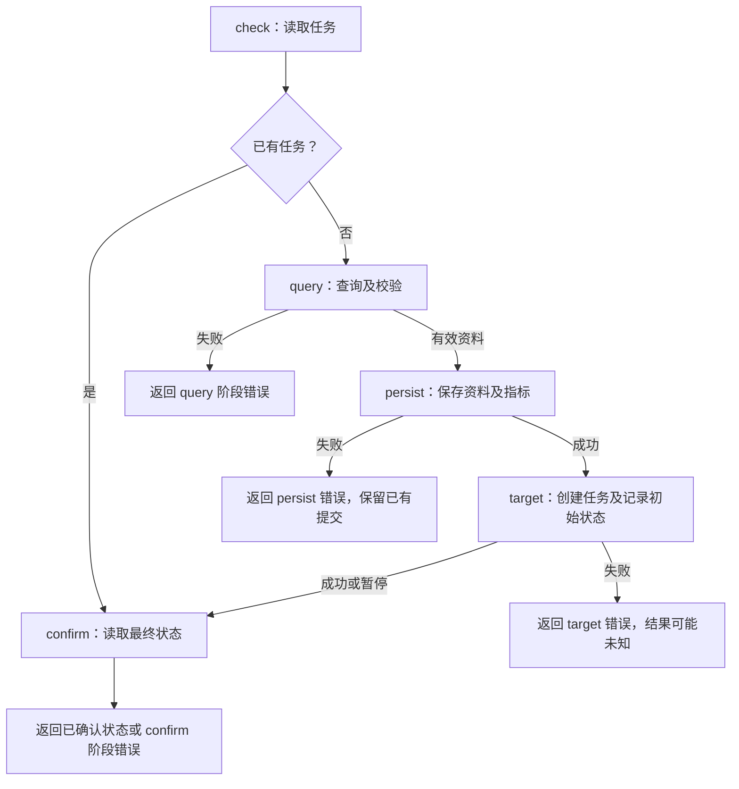

# 跟踪申请的分阶段预算与结果确认

本设计用于 8181 `POST /targets` 和 Agent 的关注核对链路。阶段预算约束执行时间，数据库事务约束单次写入的原子性；整次申请没有跨上游、资料、指标和任务的统一事务。已成功提交的资料或任务不会因为后续阶段失败而被删除。

## 阶段与预设

| stage | 职责 | 预算 | 失败后的边界 |
|---|---|---:|---|
| `check` | 读取现有任务，判断重复、暂停、繁忙或停止接纳 | 2秒 | 未开始本次写入；不能据此断言服务器没有任务 |
| `query` | 查询平台并校验标识、归属与快照指纹 | 12秒 | 未开始保存无效或失败的资料 |
| `persist` | 保存视频或作者完整资料，再保存有值的日指标 | 5秒 | 独立于请求取消；指标失败也返回错误，但已提交资料保留 |
| `target` | 幂等插入跟踪任务、核对冲突任务、记录初始成功状态 | 3秒 | 独立于请求取消；任务或部分状态可能已提交 |
| `confirm` | 再读取最终任务和资料状态 | 3秒 | 独立短预算；读取失败不能把已经建立的任务判成不存在 |

前四个预设集中于 [request_policy.go](../backend/internal/tracker/request_policy.go) 的 `DefaultRequestBudgets`；`confirm` 与整批接纳预算由 [publicapi.New](../backend/internal/publicapi/server.go) 初始化。它们是源码预设，不增加环境变量；测试注入短预算和可控依赖，不真实等待数十秒。底层 B站 HTTP 客户端仍有更严格的10秒单次传输上限，其超时也属于 `query`。

`check/query` 的预算从各阶段开始计时，同时遵守请求 context 和服务停止信号。阶段返回有效、校验通过的资料后，即使请求刚好取消或查询预算刚好结束，仍允许进入 `persist`。保存和建任务使用 `context.WithoutCancel` 保留请求值、去掉请求截止时间，再分别附加自己的短预算；不启动脱离 handler 的写入 goroutine。



纯文本流程：先检查任务；已存在或暂停的任务直接重新确认，不采集、不修改间隔。新目标查询有效资料后保存资料和指标，再建任务，最后确认。任何阶段失败返回该阶段；后续阶段不继续执行，已提交结果保留。`confirm` 失败不回滚前面的阶段。

## 应答字段与错误原因

进入业务申请流程后的单目标应答与批量逐项应答包含 `stage` 和 `outcome`，沿用现有 `ok/code/error/target/result`。非法JSON、未知路由及全局入口限流等尚未进入阶段，可以不含新字段。阶段说明错误发生的位置，业务码说明原因，不为每个阶段重复创建整套错误码。

| outcome | 含义 |
|---|---|
| `not_applied` | 本次尚未进入写入阶段；不代表公共任务原先不存在 |
| `unknown` | 可能已有部分提交，或最终状态未能确认；必须先查精确状态 |
| `confirmed` | 本次最终状态读取成功；仍需检查 `ok`、`target` 或平铺任务状态，不代表永远跟踪 |

查询、保存、建任务、确认的取消或超时使用 HTTP200、`REQUEST_TIMEOUT`；仍保留旧 `http_status:504` 作诊断。真正的存储故障使用 HTTP500、`INTERNAL_ERROR`；批量 HTTP200 中逐项报告该错误。上游失败或无效资料沿用 `TARGET_SUBMISSION_FAILED`，通过 `stage=query` 与安全的错误说明区分；暂停、忙、容量限制继续使用原业务码。进程停止接纳新工作返回 `RATE_LIMITED` 和重试提示。

错误分类优先匹配错误链中的 `context.Canceled`、`context.DeadlineExceeded`，再匹配存储标记。`database/sql` 在取消后自动回滚可能只返回 `sql.ErrTxDone`，仅对此类明确的事务结束错误，结合该阶段 context 补充取消原因。不能因为应答时 context 恰好过期，就覆盖“数据库已关闭”等不相关的真实故障；不解析驱动错误文字。

例如，资料保存超时：

```json
{
  "ok": false,
  "code": "REQUEST_TIMEOUT",
  "stage": "persist",
  "outcome": "unknown",
  "error": "保存资料和指标超时或已取消，请查询状态确认处理结果。"
}
```

无最终状态时不返回默认 `tracking:false` 冒充“已查明无任务”。确认成功后才返回平铺任务状态或 `target`；`result=created/existing` 仍只用于确认 active 的成功应答。任务可能在提交后被管理员暂停或删除，按最后读取的状态应答；暂停或缺失的确认也可为 `outcome=confirmed`，但 `ok=false`。

## 批量接纳与等待预算

每个单目标或批量请求在解析合法 JSON 后有25秒接纳预算。批量仍只处理前 N 项并顺序执行；预算耗尽后不再启动后续项目，前 N 项中未开始的合法项目返回 `stage=check/outcome=not_applied/REQUEST_TIMEOUT`。无效项保留参数错误，尾部超出 N 的项目不校验、不采集、不保存、不排队。

已经拿到有效资料或进入保存的当前项目可以继续完成 `persist/target/confirm`，最多另有5+3+3秒收尾预算。因此整批业务处理的保守上限约为36秒，而不是 N 倍单目标时限。实际限制依赖数据库和查询实现遵守 context；校验和日志等本地工作也应保持有界。不得通过把每项完整预算累加到整批时长来放大请求。

| 层级 | 预设与覆盖范围 |
|---|---|
| 服务端公共 HTTP | 读请求体10秒、写入50秒，容纳解析后最长约36秒业务处理和应答 |
| Agent → 服务器 | 状态8秒、普通读取22秒、申请55秒；包含150毫秒统一节流的等待，HTTP客户端上限55秒 |
| Agent 整次核对 | 65秒，覆盖一次状态8秒、一次申请55秒及余量 |
| Agent 刷新关注 | 90秒，覆盖核对和一次资料读取22秒 |
| Agent 本地 HTTP | 写入95秒 |
| 网页关注和详情操作 | 等待100秒；其他请求仍25秒 |

原有总览两库聚合20秒、摘要同步20秒、图片解析10秒等短预算保持各自边界；短入口取消后服务器已进入的保存仍可收尾，之后按精确状态核对。网页自身等待结束显示“操作等待超时／结果待确认”，不将其统一解释为 Agent 无法连接。

## Agent 的持久化与重试

[remote.Client](../client/agent/internal/remote/client.go) 解析 `stage/outcome` 并保留错误链；跟踪申请传输中止或应答无法解析时，无法知道服务器执行到哪一步，返回 `stage=transport/outcome=unknown`。本地节流等待期间就取消、请求尚未发出时，或本次只是只读请求时，返回 `outcome=not_applied`。旧服务器的业务应答不含新字段时保持为空，仍按原 `code` 处理。

[library.Follow](../client/agent/internal/library/service.go) 可选保存 `last_stage/last_outcome`，不升级档案版本、不删除旧缓存。`Reconcile` 继续先查状态，再决定是否申请；失败保留阶段、退避和人工处理计数，确认跟踪后清除阶段错误；切服清除旧阶段信息。未知结果的界面提示为“处理结果待确认 · 后台将先核对”。本地 HTTP 错误应答也传递两个字段。

## 停止接纳与收尾

服务端主 context 同时作为两个 HTTP 服务的 `BaseContext`，停止时取消查询。`Tracker.Stop` 关闭新工作登记并取消现有查询；已登记的显式保存继续使用自己的短预算。HTTP 的最终确认仍在同步 handler 内完成。

主入口并行等待两个 HTTP 服务 `Shutdown`（共45秒），记录错误，再等待 `Tracker.Wait` 和调度 goroutine 完成，之后才退出并关闭数据库。`RunNow` 在启动 goroutine 前登记，同样纳入等待；显式导入和周期采集也登记并遵守停止信号。`Wait` 前必须先 `Stop`，避免新增工作与等待竞态。

这不把原 [BACK-SHUTDOWN](../PLANs/2026-11-17-backend-api-freeze-review.md#back-shutdownlinux-sigterm-与后台退出链路不完整) 整项自动标记完成：发现服务的 `Close` 当前仅取消自身任务，发现分页 goroutine 的完整等待和真实 Linux 活跃任务信号验收仍需该项继续跟进。

## 实现与验证导航

- 阶段与存储边界：[request.go](../backend/internal/tracker/request.go)、[request_policy.go](../backend/internal/tracker/request_policy.go)、[阶段和收尾回归](../backend/internal/tracker/request_stages_test.go)。
- 公共应答与批量：[targets.go](../backend/internal/publicapi/targets.go)、[阶段协议回归](../backend/internal/publicapi/request_stages_test.go)、[最终任务确认回归](../backend/internal/publicapi/targets_test.go)。
- 生命周期：[tracker.go](../backend/internal/tracker/tracker.go) 的 `Stop/Wait`、[main.go](../backend/cmd/server/main.go)；模块关系见 [架构导航](architecture.md#module-navigation)。
- Agent：[远程协议回归](../client/agent/internal/remote/response_test.go)、[结果重启与重试回归](../client/agent/internal/library/request_stages_test.go)、[本地应答回归](../client/agent/internal/httpapi/request_stages_test.go)、[界面状态回归](../client/frontend/view.test.mjs)。

验证只使用可控上游和临时数据库；覆盖阶段超时、存储标记与取消并存、部分提交、确认超时后的幂等重试、批量截止后的尾部隔离、停机等待及旧协议兼容，不访问真实 B站或用户数据库。实际命令与平台结果记录在 [BACK-TIMEOUT-CODE 实施记录](../PLANs/2026-11-17-backend-api-freeze-review.md#back-timeout-code落库阶段取消超时被误报为内部故障)。
