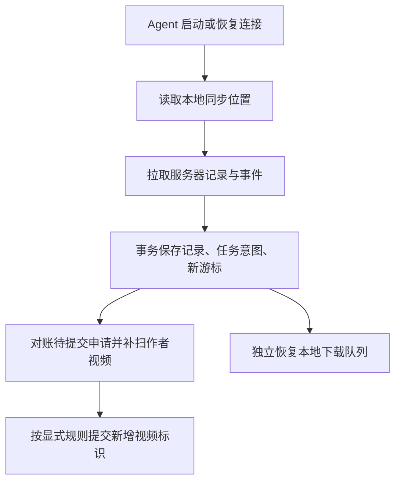

# 客户端界面与本地 Agent 设计

状态：待实施。本目录目前只有设计文档，尚无可运行的客户端或 Agent。本文定义界面、职责和验收要求，不将规划中的接口视为现有能力。产品需求见 [PRD](../docs/PRD.md)，实施记录见 [PLAN](../PLAN.md)，现有服务端模块见 [架构导航](../docs/architecture.md#module-navigation)。

## 产品目标与职责

用户在客户端查看服务器已经记录的UP主和视频信息，包括粉丝数、播放量、历史版本及观测时间；使用自己保存在本机的哔哩哔哩 Cookie，发现指定UP主当前可见的视频，选择服务器跟踪的目标，或开启本地规则自动发现新投稿。后续可以直接保存视频和评论区到本地。

服务器持续运行，保存、采集已接纳目标的历史；本地设备可以随时关闭。服务器记录是独立的数据来源，本地发现、缓存、规则、下载与文件管理由本地 Agent 负责。服务器也有自己的持久化存储，客户端缓存不能代替服务器历史库。

| 部分 | 负责 | 数据位置 |
|---|---|---|
| 服务器 | 已知目标持续跟踪、资料和指标观测、历史查询、跟踪申请校验及同步服务 | 公共元数据、历史记录、跟踪关系和未来的事件日志 |
| 本地 Agent | 服务器记录同步、Cookie 管理、平台发现、新投稿规则、提交队列、视频及评论下载 | 本地数据库、系统凭据库和用户指定目录 |
| 客户端界面 | 展示记录与来源、选择视频、配置规则、管理任务和本地文件 | 通过受控本地调用访问 Agent，不持有服务器端的平台凭据 |
| 本地平台适配器 | Cookie 会话、作者视频续页、当前访问状态、媒体与评论获取 | 平台细节及发现游标由对应适配器解释 |

“服务器的全部记录”指服务器已保存且当前调用方有权读取的记录；“UP主全部视频”指本次数据源、当前登录态和访问条件下可枚举的可见视频。两者都不承诺全站、隐藏、已删除视频或完整历史。界面使用作者与视频的通用模型，B站合集等平台组织方式只留在适配器内部。

## 运行方式与协作关系

客户端由界面和本地常驻进程组成。普通网页无法独立承担安全凭据保管、跨站登录请求、本地文件管理和关闭页面后的任务；这些能力由 Agent 提供。桌面容器、界面框架及本地通信方式在实施时选型，本设计不预设框架。

```text
┌──────────────────────────────────────────────┐
│ 客户端界面：作者、视频、规则、任务、文件          │
└──────────────────────────────────────────────┘
                       │ 本地受控调用
                       ▼
┌──────────────────────────────────────────────┐
│ 本地 Agent：同步、发现、调度、下载               │
└──────────────────────────────────────────────┘
                       │ 认证读记录、提交公共视频标识
                       ▼
┌──────────────────────────────────────────────┐
│ 服务器：历史查询、目标校验、持续采集            │
└──────────────────────────────────────────────┘
```

```text
┌──────────────────────────────────────────────┐
│ 本地 Agent                                   │
└──────────────────────────────────────────────┘
                       │ 调用本地平台能力
                       ▼
┌──────────────────────────────────────────────┐
│ 本地适配器：Cookie、分页、媒体、评论             │
└──────────────────────────────────────────────┘
                       │ 使用本地 Cookie 直接请求
                       ▼
┌──────────────────────────────────────────────┐
│ 视频平台：返回当前可访问的数据和媒体          │
└──────────────────────────────────────────────┘
```

图中箭头表示运行时调用，结果沿原调用返回。Agent 另外读写本地数据库、凭据库和文件目录；服务器使用自己的无用户凭据适配器采集公共目标，不调用客户端执行任意命令，也不代理媒体和评论下载。现有8182观察台继续承担服务器管理职责，客户端与它共享用例和记录口径。

界面与 Agent 的通信必须验证调用方；若使用本地 HTTP 桥接，需要回环监听、会话认证和来源检查，不能因来自本机就允许任意网站读取 Cookie 或发起下载。界面只展示账号摘要与登录状态，敏感凭据不回传网页页面。

## 身份、数据与状态

### 两种登录分别管理

- **服务器连接**：服务器地址、工作区及可撤销设备凭据；用于查询记录、同步和提交跟踪申请。首期可绑定当前单管理员工作区，不要求先实现注册系统；后续账户化时绑定真实用户。当前无登录的后台不等于已具备设备认证。
- **哔哩哔哩登录**：在本地设置中导入自己的 Cookie，由 Agent 验证并显示账号、有效或失效状态；优先保存在系统凭据库，本地数据库只保存凭据引用。退出清除本地凭据，暂停依赖它的任务。

Cookie 不出现在发给项目服务器的请求、同步数据、日志、URL或导出文件中，也不以明文写入浏览器 `localStorage`。服务器凭据过期只暂停服务器同步和提交；平台 Cookie 失效只暂停依赖该登录态的平台任务，两种登录互不替代。

### 本地持久化

| 数据 | 关键要求 |
|---|---|
| 服务器记录缓存 | 按服务器实例、数据代次和工作区隔离；保存来源、版本标识、指标样本、观测时间与同步时间，离线可读 |
| 本地发现记录 | 按平台和视频标识去重；保留作者、来源账号、发现时间、扫描范围和完整性，不直接覆盖服务器观测 |
| 作者发现规则 | 保存开关、扫描频率、初始基线、已知视频集合、平台续页及最后成功扫描时间 |
| 待提交队列 | 保存操作标识、目标及规则版本；重连幂等提交，收到服务端确认前不标为已跟踪 |
| 同步与任务 | 持久化收件记录、任务意图、游标、重试时间及执行状态，进程退出后恢复 |
| 文件与评论 | 路径、大小、校验、下载状态和评论快照留本地；不上传至项目服务器 |

服务器历史版本按服务器命名空间和原版本标识缓存，指标按服务器样本键更新；本地登录态观测单独保存并标注来源。仅凭当前值不能重建历史趋势；缺失观测保留缺口，不能推算成实际记录。

界面分别显示：本地已发现、待提交服务器、服务器已记录、服务器正在跟踪、本地已保存。已记录不等于仍在跟踪，停止跟踪不删除历史；本地文件存在也不代表服务器已有该视频记录。

## 页面与操作

| 页面 | 内容 | 主要操作 |
|---|---|---|
| 总览 | 服务器连接、最近同步、本地 Agent 状态、规则和任务摘要 | 连接、同步、暂停或恢复本地任务 |
| 作者列表与详情 | 服务器资料、粉丝趋势、历史版本；服务器已记录视频与本地候选分开展示 | 搜索分页、扫描可见视频、选择添加、配置新投稿规则 |
| 视频列表与详情 | 标题、作者、播放量等指标趋势、版本和观测时间；本地发现及文件状态 | 输入视频标识或链接、提交跟踪、查看历史；P1下载，P2保存评论区 |
| 跟踪与发现规则 | 服务器跟踪状态、本地作者扫描频率、规则基线与执行结果 | 分别启停服务器目标和本地发现规则，单独配置备份 |
| 任务中心 | 同步、发现、提交、下载、评论任务的进度和失败原因 | 暂停、继续、取消、重试失败项；保留已成功结果 |
| 本地文件（P1） | 文件目录、分P、大小、保存时间和完整性；P2评论快照 | 打开目录、校验、删除本地文件或导出评论 |
| 连接与账号 | 服务器地址与设备状态、本地平台账号、目录及并发设置 | 绑定或撤销设备、更新 Cookie、退出平台账号、配置启动方式 |

所有列表按需分页；未读取总量时不伪造页数。先展示已有缓存，加载更多时保留选择、滚动位置及任务进度。当前页选择与“一键添加全部”清楚区分，后者涵盖本次扫描范围的未加载页，并说明不受当前搜索筛选限制。

服务器观测时间、客户端同步时间和本地发现时间分别显示。连接中断时保留可用缓存，显示“离线，数据更新于……”；局部请求失败不清空已有列表。账号失效、限流、部分扫描、规则尚未建立基线都应有可操作提示，不只显示一个失败图标。

### 读取服务器记录

1. 连接服务器，验证设备权限，读取已保存的作者和视频记录并缓存。
2. 按需分页查询某作者的已记录视频、资料和视频版本、粉丝与播放量等指标。
3. 展示记录的真实观测区间；首次记录前和未采集区间保持空缺。
4. 手动刷新记录先同步服务器数据库。要求服务器重新采集是另一项显式操作，不把每次打开详情变成上游实时请求。

### 指定视频的手动跟踪

用户可输入平台支持的视频标识或链接，由本地适配器解析为统一标识。先展示服务器已有记录；需要补充当前登录态可见信息时，由本地 Agent 使用 Cookie 查询并标记来源。点击“提交服务器跟踪”后走同一持久化申请与服务端校验流程，不要求先扫描整个作者。仅查看、复制链接或在本地下载不自动建立服务器跟踪。

### 使用本地 Cookie 获取作者可见视频

1. 用户输入平台与作者标识，选择本地平台账号，启动扫描。
2. 本地适配器逐页枚举、归一化视频；Agent 跨页去重，界面按需读取本地候选页。扫描与界面分页互相独立，首屏不等待全量扫描完成。
3. 展示“扫描中／当前可见范围扫描完成／部分完成”及原因。Cookie 失效或需要验证时暂停并提示用户；有上限地退避处理临时错误和限流，无效凭据、永久错误或不前进的游标不无限重试。
4. 历史候选默认全部不勾选，扫描本身不建立服务器跟踪。提供逐项添加与跨页“一键添加全部”；已确认跟踪的目标不重复添加。
5. 添加全部由 Agent 在本地持久化意图，覆盖已扫描及本次尚未扫描的页，分批提交唯一视频标识。达到预算或失败时保留成功项，显示未完成范围，不能报告全部完成。
6. 服务器只接收平台、作者、视频标识及必要的幂等请求信息，重新查询并校验归属和可采集性；本地 Cookie、原始响应和私有元数据不上传。仅本地可访问的候选可保留在本地，但不能伪报服务器成功。
7. 按逐项确认结果显示已跟踪、已存在、拒绝或可重试失败；请求超时先对账，不直接重复创建目标。

服务器公开发现和本地 Cookie 发现均可贡献候选，但来源和覆盖范围要清楚。合并只按 `(platform, video_id)` 去重，不用本地观测覆盖服务器历史，也不向通用界面暴露合集等平台目录。

### 跟踪作者的新投稿

“跟踪UP主资料”只影响服务器资料采集。“跟踪UP主新视频”是本地周期发现规则，必须另外开启；开启时明确提示：设备停止运行期间会暂停新视频发现，已有服务器目标继续采集。

- 首次扫描完成当前可见范围后建立基线；基线内历史视频保持未选，由用户另行选择或一键添加全部。扫描未完成时显示“建立基线中／需恢复”，不能把部分历史误认成新投稿。
- 基线建立后定时扫描，结合已知视频标识、重叠页与平台续页判断新增；按用户开启的“新视频提交服务器跟踪”策略排队。不只比较投稿时间，也不因第一页出现旧视频就立即结束。
- 恢复运行后覆盖离线区间，必要时扫描多页或重新扫描当前可见范围。平台游标失效则重新枚举并去重；新发现但无法确认是否基线后新增的条目保留候选，交给用户处理。
- 自动下载默认关闭，可另选仅下载规则生效后新增的视频。历史视频的批量下载是独立的显式操作；评论区保存也单独开启。
- 关闭本地规则停止后续发现与未发送的规则申请，已发送的请求先对账；不自动取消服务器已存在的视频跟踪，也不删除本地文件。停止服务器目标是另外的操作。

## 离线、重启与同步

| 情况 | 服务器行为 | 本地行为 |
|---|---|---|
| 本地设备关闭 | 继续采集已接纳目标和保存记录 | 不发现新投稿、不下载；恢复后同步记录并补扫描 |
| 服务器断连 | 服务端是否采集以其实际运行状态为准 | 可读缓存；有效 Cookie 下继续本地发现与下载，申请排队 |
| Cookie 失效 | 不影响服务器公共采集 | 同步服务器记录仍可继续；依赖该账号的任务等待更新凭据 |
| Agent 重启 | 不依赖 Agent 执行已知目标采集 | 从本地数据库恢复同步位置、规则、提交和未完成任务 |

恢复顺序是：读取已提交的同步位置 → 拉取服务器记录或事件 → 在本地事务中保存记录、派生任务意图与新游标 → 对账待提交申请并补发现 → 独立调度可执行的本地下载。记录同步和平台发现使用不同游标。



文字说明：下载完成不是同步确认的前提；只要记录与任务意图已一起落盘，就可以推进记录游标。崩溃重放事件不能重复创建任务；下载失败不应造成服务器记录反复同步。提交队列单独持久化确认状态，取消或修改规则时检查规则版本，避免离线旧操作重连后继续生效。

同步游标过期时获取状态快照并对账，再恢复增量；快照只能恢复当前状态，可保留的历史另行分页读取，不能编造已清理事件。服务器实例或数据代次变化时切换同步命名空间。多个设备使用各自的游标与队列，服务器对同一公共目标复用采集。

服务器发现会话和批量任务当前仅在内存保留约20分钟，不能充当可靠离线队列或永久同步游标。设备必须持久化自己的申请并查询实际跟踪状态；将来新增的事件同步需要服务端持久化日志和稳定协议。

服务器只能继续采集已经知道且当前能查询的目标。仅依赖本地 Cookie 才能发现的新投稿，离线期间可能未知；恢复时已经消失的内容或缺失的指标不能保证补齐。登录态列表“扫描完成”也只代表当次可见范围。

## 本地下载与评论扩展

### 视频下载（P1）

下载由 Agent 直接连接平台完成，服务器不解析和转发播放地址。用户选择本地目录、清晰度、分P范围及并发；自动下载默认关闭，手动下载与服务器跟踪互不作为必要前提。

任务保存排队、执行、暂停、等待重试、等待凭据、完成、取消和当前不可获取等状态。平台临时地址过期时重新解析；仅在上游支持续传时恢复分片，不能将不完整文件标为完成。完成前校验预期长度或可用校验信息，安全写入最终文件，记录格式、大小和保存时间。

磁盘不足、目标目录不可写、凭据失效和内容不可访问分别提示；临时错误有限退避，永久错误等待用户处理。输出路径由本地目录和经过清理的名称生成，服务器不得指定任意本地路径或执行命令。

### 评论区保存（P2）

用户针对视频单独启用，允许不下载视频只保存评论区。Agent 分页读取当前可见的根评论及回复，按评论标识去重，保存视频和评论标识、父子关系、发布时间、内容、观测时间及本次范围。

以快照区分各次观测，记录扫描模式、已完成页、失败和截断原因；支持本地查看与 JSON/JSONL 等格式导出。列表变化、权限或限流可能造成不完整，不能用平台显示的总数证明已保存全部评论，也不能重建首次观测前已删除的内容。正文、用户相关字段及导出文件留在本地，不进入服务器历史库。

## 接口依赖与现状

以下是实施依赖，不是现有 API 承诺；路由和载荷在协议设计时确定。

| 能力 | 当前实现 | 客户端接入要求 |
|---|---|---|
| 上游即时元数据查询 | 8181 `/api/v1/platforms/{platform}/videos/{id}` 及作者查询只查上游，不读取历史库 | 不能拿它当历史同步接口 |
| 已记录内容与历史浏览 | 8182已有本地只读页面、指标 JSON、作者 `scope=recorded` 视频分页 | 补齐受鉴权的作者、视频、版本与指标读取协议；保留来源、观测时间和稳定分页 |
| 公共视频发现与导入 | 8182已有 `scope=available`、批量导入和进度；会话有界且短期保存在内存 | 复用服务端校验和写入用例，增加设备认证、可重放的申请确认与对账；不直接向外暴露后台 |
| 身份与工作区 | 单管理员工作区，无用户表与设备认证；JSON来源检查不是登录 | 首期增加可撤销设备认证、读写权限和工作区归属，再扩展真实账户 |
| 持久化变化同步 | 尚无事件日志、设备游标和快照重置协议 | 实现持久化事件、增量读取、快照、实例及数据代次标识；不能复用发现游标 |
| 本地 Agent 与平台登录 | 未实现 | 本地通信、凭据库、缓存、分页发现、规则及提交队列 |
| 视频及评论保存 | 未实现 | 本地平台适配、持久化任务与文件管理，分阶段接入 |

设备权限至少区分记录读取、同步读取和跟踪写入；服务器每次请求重新检查工作区权限。当前“管理员关注”映射为全局启用目标，后续按真实用户订阅计算，不能永久把所有设备都视为共享管理员身份。平台作者 UID 不属于本系统用户身份。

本地适配器与服务器适配器可以共用不含凭据的模型、解析和校验约定，但运行边界与请求客户端分开；Cookie 只注入本地能力，不能通过共享环境变量或复用客户端意外进入服务器公开发现。现有作者视频接口边界见 [视频发现设计](../docs/video-discovery.md)。

## 实施阶段与验收

| 阶段 | 范围 | 验收重点 |
|---|---|---|
| P0：记录与发现闭环 | 设备连接、记录浏览和缓存、本地 Cookie、分页候选、新投稿规则、跟踪交接、离线恢复与持久化同步 | 先补服务端接口和认证，再连接本地 Agent 与界面；不依赖媒体下载 |
| P1：本地视频保存 | 手动或按规则下载、恢复任务、文件查看及清理 | 直接平台到本地，不完整文件不能标完成 |
| P2：本地评论区保存 | 根评论和回复分页、快照、查看及导出 | 独立开关、完整性可见、正文只留本地 |

必要验收场景：

- 多页作者视频默认均未选，一键添加全部包含已展示未选项和未加载页；取消、重试及重启保留成功结果。
- 单纯关注作者资料不会自动关注视频；新投稿规则初始基线不自动添加历史，规则新增去重，自动下载默认关闭。
- 本地停止超过一个扫描周期且新增超过一页，恢复后补发现；服务器已知视频继续观测，未知或已消失内容不伪造历史。
- 服务器记录、指标与本地候选分别显示来源和时间；无观测区间不插值为真实采集，离线浏览明确显示缓存状态。
- 在事件落盘前后分别模拟崩溃，不丢记录、不跳过事件、不重复生成任务；下载失败不阻塞同步游标，失效游标可重新对账。
- 服务器断连时发现可继续且申请不丢；重复提交、请求超时与规则取消正确对账，服务端未接纳前不显示已跟踪。
- 平台 Cookie 不进入服务器请求或日志；服务器认证与平台登录分别失效，互不错误阻断；设备撤销后不能继续读写受保护接口。
- P1验证暂停恢复、地址过期、磁盘不足及文件完整性；P2验证根评论与回复去重、中断恢复、部分结果标识及本地导出。

本次只建立文档和实施计划；完成以上能力及相应验证后，再将计划标记完成。
