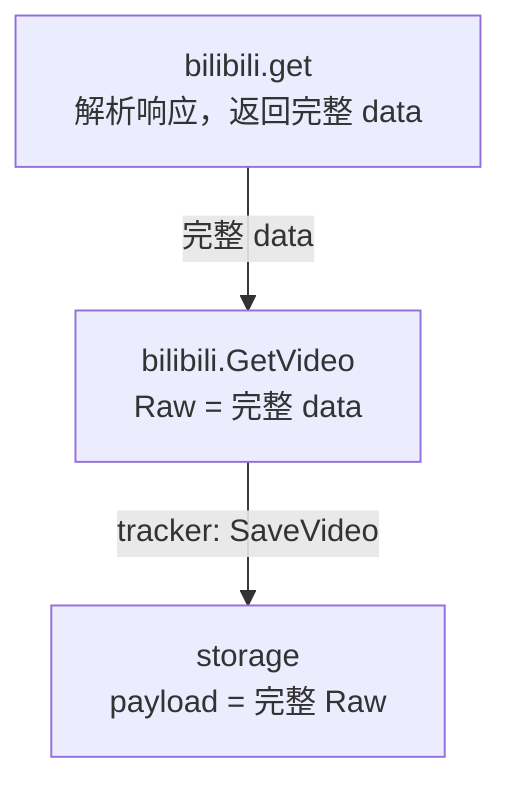
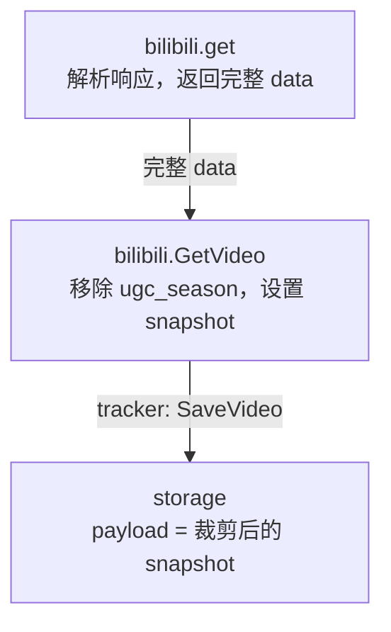

# 下一步计划

后续新增计划放在最上面，保留已有计划及其执行状态。

## 1. 裁剪视频快照，过滤合集中的其他视频数据

- 状态：已完成（2026-11-08，已调整为过滤版本仅保留在代码中）。已实现适配器裁剪及 schema 3 兼容迁移，移除多余的过滤版本入库字段和传递逻辑。历史 payload 未自动裁剪。
- 目标：单个视频的版本只保存该视频的上游业务快照，避免每个视频重复携带整个合集的视频列表。
- 已实施方案：在 B 站视频适配器中移除顶层 `ugc_season`，其他字段及其嵌套内容保留。顶层 `season_id` 等归属信息保留，当前视频的 `pages` 分 P 信息保留。

### 优化前如何处理（历史设计）

作者查询后，[tracker.go](backend/internal/tracker/tracker.go) 的 `discoverVideos()` 调用 [list.go](backend/internal/provider/bilibili/list.go) 发现 BV，再逐个调用 `runVideo()` 查询单视频。发现列表本身没有直接写进视频版本；膨胀来自单视频 `/x/web-interface/view` 响应中的 `ugc_season`。

- [http.go](backend/internal/provider/bilibili/http.go) 的 `get()` 校验 HTTP 状态、业务码并解析响应，同时返回未经裁剪的 `envelope.Data`。
- [bilibili.go](backend/internal/provider/bilibili/bilibili.go) 的 `GetVideo()` 将部分字段转换为统一结构，并将完整 `data` 放入 `source.Video.Raw`。结构体忽略未知字段不会裁剪这份独立保存的 `Raw`。
- [repo.go](backend/internal/storage/repo.go) 的 `SaveVideo()` 在首次保存或内容指纹变化时调用 `insertVideoVersion()`，将 `video.Raw` 原样写入 `video_versions.payload`；内容未变时不新增版本。
- [admin/server.go](backend/internal/admin/server.go) 的详情页读取并格式化展示已存 payload，因此合集内容也会出现在视频详情中。

这是旧的“保留完整上游 data，方便历史重新解析”策略。`ugc_season` 不参与内容指纹，但在旧快照中被重复存档；[docs/database.md](docs/database.md) 的“payload 保存什么”已更新为裁剪后的契约。

### 选择在哪里优化

已选择在 `bilibili.GetVideo()` 完成身份校验后、返回 `source.Video` 前，调用 [snapshot.go](backend/internal/provider/bilibili/snapshot.go) 的 `videoSnapshot()`。由了解 B 站数据结构的适配器决定快照范围；模块内常量 `videoSnapshotVersion` 选择当前过滤实现，不随数据传递或入库。`http.go` 保留通用传输与响应校验，`tracker` 协调调用，`storage` 保存收到的快照并保证事务一致性。

下图表示数据传递和处理关系，不表示包导入关系；`SaveVideo` 仅在首次保存或内容变化时写版本。

优化前：



优化后：



等宽字符版（保留原图，供纯文本环境和 diff 查看）：

```text
优化前：

+----------------------------------+
| bilibili.get                     |
| parse response; return full data |
+----------------------------------+
                 |
                 | full data
                 v
+----------------------------------+
| bilibili.GetVideo                |
| Raw = full data                  |
+----------------------------------+
                 |
                 | tracker: SaveVideo
                 v
+----------------------------------+
| storage                          |
| payload = full Raw               |
+----------------------------------+

优化后：

+----------------------------------+
| bilibili.get                     |
| parse response; return full data |
+----------------------------------+
                 |
                 | full data
                 v
+----------------------------------+
| bilibili.GetVideo                |
| remove ugc_season; set snapshot  |
+----------------------------------+
                 |
                 | tracker: SaveVideo
                 v
+----------------------------------+
| storage                          |
| payload = filtered snapshot      |
+----------------------------------+
```

### 同一份数据优化前后的效果

对本地 `backend/data/bht.db` 中 `BV18M4m1y7ga` 的一条版本进行只读采样：原始 payload 为 213,419 字节，`ugc_season` 内有 128 个视频条目，其中 127 个属于其他 BV；顶层 `pages` 有 1 个分 P。

最初将这同一份 JSON 在内存中移除 `ugc_season` 并紧凑序列化后，为 2,821 字节，减少约 98.7%。该数值来自实施前的裁剪模拟，不代表数据库文件已缩小；当前规则不自动裁剪历史 payload。Go 的 JSON 编码方式可能造成实际字节数略有差异。

| 对比项 | 优化前 | 优化后（已实现，样本大小为模拟值） |
|---|---|---|
| 当前视频的身份、内容、统计等字段 | 保留 | 保留 |
| 当前视频顶层 `pages` | 保留 1 个分 P | 仍保留 1 个分 P |
| 顶层 `season_id` | 保留 | 保留 |
| `ugc_season` 合集对象 | 保留整个对象及 128 个条目 | 整个对象过滤，不保留合集内的当前视频副本或其他视频 |
| 样本 payload 大小 | 213,419 字节 | 模拟为 2,821 字节 |
| 内容指纹 | 基于现有内容字段投影 | 保持一致；`ugc_season` 原本就不参与 |
| 内容未变时的版本行为 | 不新增版本 | 保持不新增版本 |
| 详情页 | 当前视频内容夹带整个合集 | 展示裁剪后的当前视频快照 |

字段图例（同一份样本的结构示意，省略具体值；`[=]` 保留，`[-]` 过滤）：

```text
优化前 data                          优化后 snapshot
├─ [=] bvid / aid                     ├─ bvid / aid
├─ [=] title / desc / desc_v2          ├─ title / desc / desc_v2
├─ [=] pic / pubdate / duration       ├─ pic / pubdate / duration
├─ [=] owner / stat / dynamic         ├─ owner / stat / dynamic
├─ [=] pages[1]                       ├─ pages[1]
│      └─ 当前 BV 的分 P              │  └─ 当前 BV 的分 P
├─ [=] subtitle / rights / state      ├─ subtitle / rights / state
├─ [=] season_id                      ├─ season_id
├─ [=] 其他顶层字段                   └─ 其他顶层字段
└─ [-] ugc_season                     （不再有 ugc_season）
       ├─ id / title / cover / ...
       └─ sections[]
          └─ episodes[128]
             ├─ 当前 BV 的合集内副本
             └─ 其他 127 个 BV 的数据
```

样本中实际存在的顶层字段按以下规则处理；表中“保留”均包含其原有嵌套字段，并非重新用精简结构体构造快照。

| 字段类别 | 优化前已有字段 | 优化后处理 |
|---|---|---|
| 身份与分区 | `bvid`、`aid`、`videos`、`tid`、`tid_v2`、`tname`、`tname_v2`、`copyright` | 全部保留 |
| 内容与时间 | `pic`、`title`、`pubdate`、`ctime`、`desc`、`desc_v2`、`duration`、`dynamic` | 全部保留 |
| 作者、统计与状态 | `owner`、`stat`、`state`、`rights`、`mission_id`、`argue_info` | 全部保留 |
| 当前视频分 P 与字幕 | `cid`、`dimension`、`pages`、`subtitle` | 全部保留，尤其不能将分 P 当成其他视频删除 |
| 合集归属与显示标记 | `season_id`、`is_chargeable_season`、`is_season_display` | 全部保留；仅保留关联和标记，不保留合集详情 |
| 其他现有字段 | `premiere`、`teenage_mode`、`is_story`、`is_upower_exclusive`、`is_upower_play`、`is_upower_preview`、`enable_vt`、`vt_display`、`is_upower_exclusive_with_qa`、`is_hua_sheng`、`no_cache`、`user_garb`、`honor_reply`、`like_icon`、`need_jump_bv`、`disable_show_up_info`、`is_story_play`、`is_view_self` | 全部保留 |
| 合集详情及所有视频条目 | `ugc_season`，含 `id`、`title`、`cover`、`mid`、`intro`、`sign_state`、`attribute`、`stat`、`ep_count`、`season_type`、`is_pay_season`、`enable_vt`、`sections` 及其全部后代 | 整个 `ugc_season` 删除，不影响顶层同名或其他路径的字段 |

### 实施约束与验收

- 使用 `map[string]json.RawMessage` 等保留未知字段的方式定点删除顶层 `ugc_season`，不将当前精简的 `videoData` 重新序列化为快照，避免丢失 `pages`、`dynamic` 等字段。没有 `ugc_season` 的视频也应正常处理。
- 第一阶段只过滤该字段；其他未列出的上游字段继续保留，后续根据实测确认是否包含其他跨视频内容，再单独扩展规则。作者资料和投稿发现接口不应用这套视频裁剪规则。
- 与下方指纹解耦计划协调：分别定义“保存哪些字段”和“哪些字段参与指纹”，并验证同一份响应裁剪前后的现有内容指纹相同。
- 过滤规则版本只在适配器代码中管理，通过 `videoSnapshotVersion` 选择实现；不放入 `source.Video`、不随 JSON 传递、不增加数据库字段。`Raw` 表示准备好的业务快照，不再称为“未经修改的完整上游 data”。`hash_version` 保留其指纹比较用途。
- 新逻辑只影响后续需要写入的快照；内容指纹未变时，不因裁剪规则变化强制新增内容版本，已有大快照仍会被详情页读取。历史 payload 的裁剪和数据库空间回收另行评估，不在实施过滤时自动改写历史。
- 测试覆盖：含其他 BV 的合集被过滤；当前视频所有 `pages`、内容与统计字段保留；未知字段保留；无合集视频正常；指纹不变；需要保存的新版本写入裁剪后的 payload，详情可以正常读取。
- 实施时同步更新 [docs/database.md](docs/database.md)、[docs/architecture.md](docs/architecture.md) 以及 Provider、source、storage 的相关注释和说明，修正旧的“data 原样不裁剪”约定。

### 完成记录

- [snapshot.go](backend/internal/provider/bilibili/snapshot.go) 通过包级常量 `videoSnapshotVersion = 1` 选择 `videoSnapshotV1()`，只裁剪顶层 `ugc_season`，不递归过滤；没有该字段时保留原始 JSON。
- 过滤版本曾随数据入库，现已按当前约定移除 `source.Video.SnapshotVersion`、详情结果及 [repo.go](backend/internal/storage/repo.go) 的读写传递。读取 payload 无需过滤版本；现有 `hash_version = 1` 不变。
- [0003 迁移](backend/internal/storage/migrations/0003_drop_video_snapshot_version.sql) 删除 `snapshot_version`，保持 payload、指纹和内容序号。保留此前已经执行的 [0002](backend/internal/storage/migrations/0002_video_snapshot_version.sql)，schema 升为 3，不修改旧迁移，不自动触发新内容版本。
- [snapshot_test.go](backend/internal/provider/bilibili/snapshot_test.go) 覆盖合集过滤、全部其余字段及嵌套同名字段保留、大整数精度、无合集和空合集字段、指纹兼容、作者资料不裁剪、快照入库与后台详情、新旧格式共存。
- [migration_test.go](backend/internal/storage/migration_test.go) 覆盖 schema 1、schema 2 完整快照与裁剪快照升级，验证多余列已删除、历史内容和版本指针不变、重复打开及数据库完整性。
- 验证命令（`backend` 目录）：`go test ./...`、`go vet ./...`、`go build -o bin/server.exe ./cmd/server`，全部通过。已同步更新模块注释、README、架构与数据库设计文档。
- 后续运行新版服务时自动迁移数据库结构；已有内容未变的目标仍显示旧快照，首次保存或真实内容变化时使用新快照。历史数据裁剪及空间回收不属于本项实施范围。

## 2. 解耦 data 指纹操作

- 状态：待实施。
- 将 `backend/internal/storage/fingerprint.go` 中 B 站 `data` 的字段投影、规范化和指纹生成逻辑移到 `backend/internal/provider/bilibili`，由哔哩哔哩适配器决定哪些数据参与指纹。
- 查询结果携带指纹及其算法版本，`tracker` 负责协调查询和保存，`storage` 接收结果并完成比较、版本写入与事务处理，不再解析 B 站原始字段或决定指纹规则。
- 保留现有内容变化判断：粉丝数、播放量等统计变化不产生内容版本；头像、封面 URL 的参数变化不误判为内容变化。
- 迁移时核对现有指纹兼容性，并明确算法版本变化时的比较策略；同步调整相关测试、模块注释和技术文档。

## 3. 评估并优化部分 `storage.Store` 依赖

- 状态：待评估。
- 检查 `tracker.Tracker`、`tracker.Scheduler` 和 `admin.Server` 对 `*storage.Store` 的依赖，按各自实际需要的能力评估是否改为小接口。
- 优先评估只使用 `DueTargets`、`MarkTargetRun` 的调度器；结合收益再确定其他组件的调整范围。
- 检查 `storage.Target` 等共享类型的职责，区分调度数据与后台展示数据，避免仅替换接口却继续混合职责。
- 保留入口 `cmd/server` 对具体存储实现的创建和组装，以及当前记录、历史版本和版本指针的事务一致性。
- 评估后确定实施范围，再同步调整必要的测试、模块注释和技术文档。
